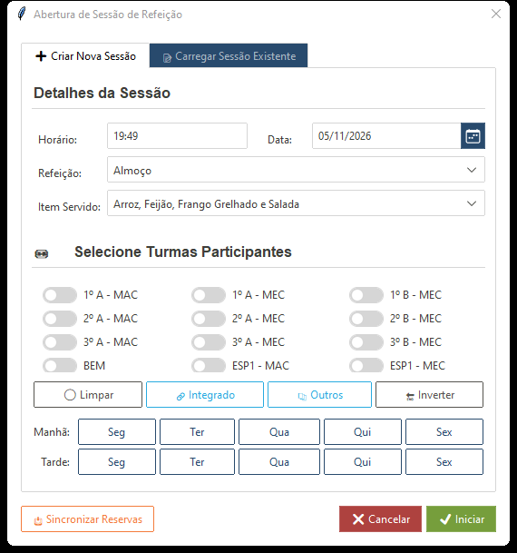
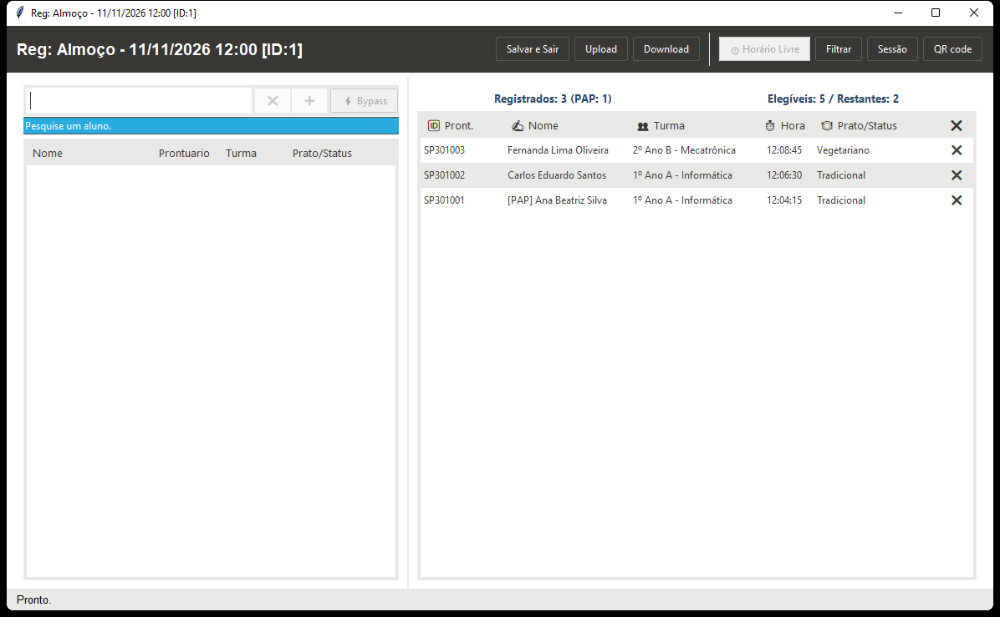
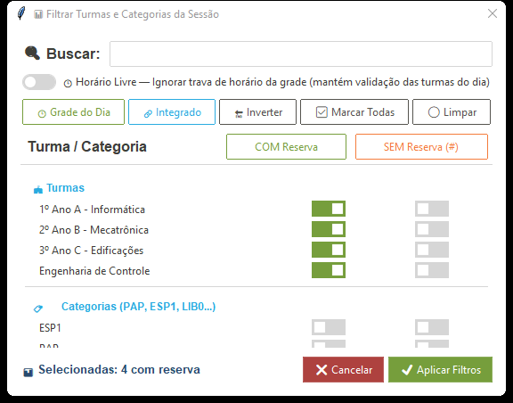
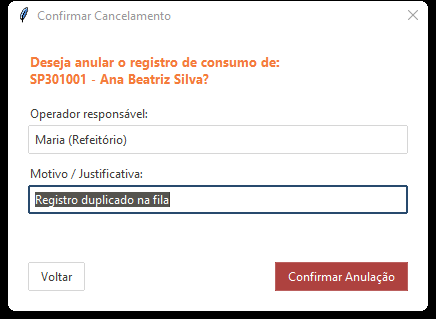
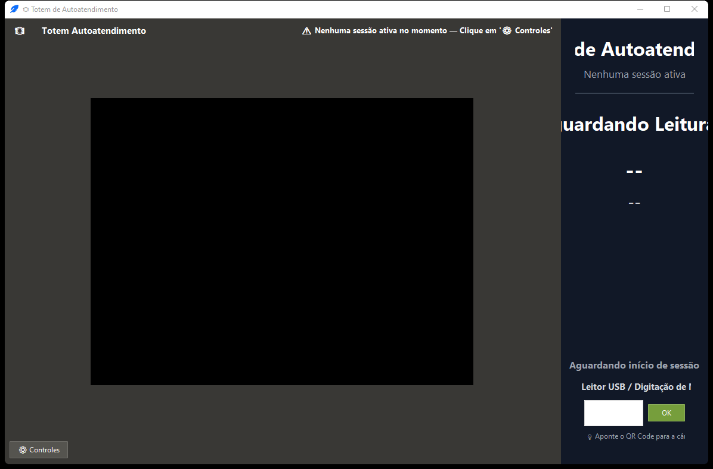
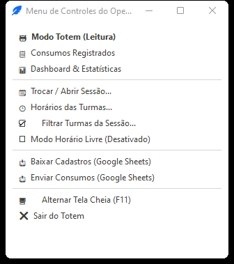
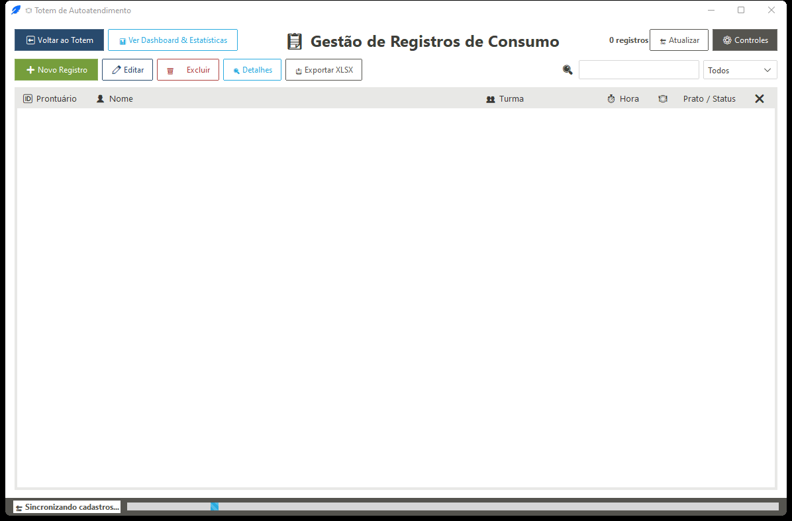

# ⚡ Guia Rápido de Operação Diária — Sistema de Refeitório (v1.3.0)

Guia prático de consulta rápida para o atendimento diário no **Terminal do Operador (`--reg`)** e no **Totem de Autoatendimento (`--auto`)**. Para detalhes avançados de configuração e arquitetura, consulte o [Manual Completo do Usuário](./MANUAL_DO_USUARIO.md).

---

## 1. Início do Turno e Abertura de Sessão

1. Abra o **Menu Inicial** (`uv run python -m registro` ou atalho na Área de Trabalho) e escolha **Terminal do Operador** (`--reg`) ou **Totem de Autoatendimento** (`--auto`).
2. Antes de iniciar a fila, confira a sessão ativa na barra superior:
   * **No Terminal:** clique em **Sessão**.
   * **No Totem:** pressione **`F2`** (ou **`Ctrl+M`** / **botão direito**) ➔ **📆 Trocar / Abrir Sessão...**.

* **➕ Criar Nova Sessão:** escolha **Refeição** (`Almoço`, `Jantar` ou `Lanche`), **Data**, **Período** e marque as **Turmas/Categorias** autorizadas (use os atalhos **🕒 Grade do Dia** ou **📋 Com Reserva**).
  * Se acabou de atualizar reservas na planilha, clique em **📥 Sincronizar Nuvem** no rodapé antes de criar.
* **📂 Carregar Sessão Existente:** dê **duplo clique** na sessão desejada para retomá-la.

> [!IMPORTANT]
> Sessões de **Almoço** e **Jantar** só podem ser criadas se existir pelo menos **uma reserva ativa** no banco para a data e turno selecionados. Sessões de **Lanche** não exigem reservas prévias.

---

## 2. Terminal do Operador (`--reg`)

Interface de balcão para busca rápida, liberações especiais e estornos com auditoria.

### Como Buscar e Registrar
* **Busca inteligente:** digite **nome**, **parte do nome** ou apenas os **números da matrícula** (não precisa digitar `IQ` ou `SP`).
* **Curingas úteis:**
  * `todos`, `---`, `***` ou `..` ➔ lista todos os alunos pendentes na sessão.
  * `ana, 1º ano` ➔ filtra por nome e turma ao mesmo tempo.
  * `ana.` (ponto final no termo) ➔ ativa busca global ignorando os filtros de turma da sessão.
* **Confirmar presença:** pressione **`Enter`** (ou dê **duplo clique** na linha).
* **Bypass pontual (`Shift + Enter`):** força o registro ignorando trava de grupo e grade horária apenas para aquele aluno (ou ative o toggle **`⚡ Bypass`** para múltiplos casos seguidos).

### Filtros de Turmas e Liberação Sem Reserva (`#`)
Clique em **Filtrar** na barra superior para ajustar quem pode passar na sessão:

* **`COM Reserva`:** autoriza alunos do grupo que possuem reserva válida.
* **`SEM Reserva (#)`:** libera o grupo como **Exceção** — alunos dessa turma/categoria passam mesmo sem reserva prévia (registrado como `Sem Reserva (Grupo)` / `#`).
* **`🕒 Horário Livre`:** desativa temporariamente a trava de horário da grade para a sessão atual.

### Cancelar / Estornar um Registro
1. Na tabela da direita (**Registrados**), clique no ícone **`❌`** da linha (ou selecione e pressione **`Delete`** / **`BackSpace`**).
2. Informe o **Operador responsável** e o **Motivo / Justificativa** e clique em **Confirmar Anulação**.

> [!NOTE]
> O estorno devolve o aluno para a lista de elegíveis, libera sua cota diária e registra a auditoria na aba `Consumo_Cancelados`.

---

## 3. Totem de Autoatendimento (`--auto`)

Interface autônoma para leitura de crachás (QR Code pela câmera, leitor USB ou digitação manual de matrícula).

### Operação na Fila
* **Leitura automática:** o estudante aproxima o QR Code da câmera ou passa no leitor USB (ou digita a matrícula). Qualquer tecla digitada na tela vai automaticamente para o campo de entrada, mesmo fora de foco.
* **Feedback imediato:**
  * **Tela Verde + Bipe agudo:** passagem liberada (`LIBERADO!`).
  * **Tela Vermelha/Laranja + Bipe grave:** bloqueio (sem reserva, fora do horário da turma ou consumo duplicado).
* **Consulta pública de horários:** clicando em **`🕒 Horários por Turma`** (ou no subtítulo da refeição), os alunos veem os turnos (`LIBERADO AGORA`, `EM BREVE`, `ENCERRADO`). A janela fecha sozinha em **15 segundos** — e, se alguém passar o crachá no leitor USB enquanto ela estiver aberta, a leitura é capturada normalmente.

### Menu Administrativo do Totem (`F2` / `Ctrl+M` / Botão Direito)
Para acessar os controles sem sair do Totem, use **`F2`**, **`Ctrl+M`**, clique em **`⚙️ Controles`** ou clique com o **botão direito** em qualquer ponto da tela (inclusive sobre o vídeo). Se houver PIN configurado, digite-o na tela ou no teclado numérico.

| Ação no Menu | Quando usar |
| :--- | :--- |
| **📋 Consumos Registrados** | Conferir a lista, ver detalhes (`duplo clique`), editar horário/prato, lançar **➕ Novo Registro** manual ou estornar (`❌` / `Delete`). |
| **📊 Dashboard & Estatísticas** | Acompanhar total servido, alunos restantes, taxa de adesão e ritmo da fila em tempo real. |
| **☑️ Filtrar Turmas da Sessão...** | Liberar uma turma antecipada (`COM Reserva` / `SEM Reserva #`) sem encerrar o Totem. |
| **Modo Horário Livre** | Ativar/desativar rapidamente a tolerância de horário para toda a sessão. |
| **🖥️ Alternar Tela Cheia (`F11`)** | Entrar ou sair do modo quiosque (ou pressione `Esc` para sair). |

---

## 4. Fechamento do Turno (Google Sheets e Excel)

Ao encerrar o atendimento da refeição:

1. **Enviar dados para a nuvem:**
   * **No Terminal:** clique em **Upload** (ou **Salvar e Sair** / fechar no **`X`**, que já executa o envio automático).
   * **No Totem:** abra o menu (`F2`) ➔ **📤 Enviar Consumos (Google Sheets)** — ou use **❌ Sair do Totem**, que salva a sessão e sincroniza pendências (timeout de até 8s caso esteja sem internet).
2. **Exportar planilha Excel (`.xlsx`) da sessão:**
   * No Totem, acesse **📋 Consumos Registrados** ➔ **📥 Exportar XLSX** (ou **📊 Dashboard & Estatísticas** ➔ **📥 Exportar Relatório de Sessão (XLSX)**).
   * O arquivo é salvo automaticamente na pasta **Documentos** do usuário, incluindo a aba `Cancelados` quando houver estornos.

> [!TIP]
> Se a sessão for **Lanche**, aguarde a barra de progresso inferior concluir o envio antes de fechar a janela.

---

## 5. Imprevistos Comuns, Reservas e Crachá Rápido

| Situação na Fila | Como resolver na hora |
| :--- | :--- |
| **Aluno esqueceu o crachá** | No Terminal (`--reg`), busque pelo **Nome** ou últimos dígitos da matrícula e tecle `Enter`. No Totem, use **📋 Consumos Registrados** ➔ **➕ Novo Registro**. |
| **Leitura dupla ou erro de lançamento** | Estorne pelo **`❌`** (ou `Delete`) no Terminal ou na aba **Consumos** do Totem, preenchendo Operador e Motivo. |
| **Turma liberada antes do horário** | Abra **Filtrar Turmas da Sessão...** e marque a turma (ou ative **Horário Livre** no menu). |
| **Aluno sem reserva ou prato trocado** | Para ajuste definitivo, abra o **Painel Administrativo (`--painel`)** ➔ aba **Reservas** (**Nova Reserva** ou duplo clique para editar). Para ajuste pós-registro, dê duplo clique no item em **Consumos** do Totem. |
| **Aluno novo sem crachá QR** | Cadastre no **Painel (`--painel`)** ➔ aba **Alunos** e gere o cartão unitário pelo **Gerador de Crachás (`--cards`)** em PDF/HTML. |

---

## 6. Cola de Atalhos de Teclado

| Onde | Atalho | Função |
| :--- | :--- | :--- |
| **Terminal (`--reg`)** | `Enter` / `Duplo clique` | Registra o aluno selecionado |
| **Terminal (`--reg`)** | `Shift + Enter` | Registra com **Bypass** (ignora trava de grupo/horário) |
| **Terminal (`--reg`)** | `↑` / `↓` | Navega na lista sem sair da caixa de busca |
| **Terminal (`--reg`)** | `Esc` | Limpa o campo de busca |
| **Terminal / Totem** | `Delete` / `BackSpace` | Abre cancelamento/estorno do item selecionado |
| **Totem (`--auto`)** | `F2` / `Ctrl+M` / `Botão direito` | Abre o **Menu de Controles do Operador** (pede PIN se ativo) |
| **Totem (`--auto`)** | `F11` / `Esc` | Alterna ou sai do modo **Tela Cheia** |
