# 🍽️ Manual do Usuário — Sistema de Registro de Refeições

Bem-vindo ao **Manual Oficial do Usuário** do Sistema de Registro de Refeições. Este guia detalhado foi desenvolvido para orientar administradores, equipes de TI, operadores de refeitório e estudantes no uso cotidiano de todos os módulos da aplicação.

---

## 📑 Sumário

1. [Visão Geral e Arquitetura do Sistema](#1-visão-geral-e-arquitetura-do-sistema)
2. [Instalação, Requisitos e Inicialização](#2-instalação-requisitos-e-inicialização)
3. [Lançador Central (`registro`)](#3-lançador-central-registro)
4. [Central de Início Rápido e Configurações (`setup`)](#4-central-de-início-rápido-e-configurações-setup)
5. [Painel Administrativo (`painel`)](#5-painel-administrativo-painel)
   - [5.1 Gestão de Estudantes](#51-gestão-de-estudantes)
   - [5.2 Gestão de Turmas e Cursos](#52-gestão-de-turmas-e-cursos)
   - [5.3 Controle de Reservas de Refeições](#53-controle-de-reservas-de-refeições)
   - [5.4 Carga em Lote e Importação Inteligente](#54-carga-em-lote-e-importação-inteligente)
   - [5.5 Dashboard Gerencial e Relatórios](#55-dashboard-gerencial-e-relatórios)
6. [Terminal de Registro do Operador (`registrar`)](#6-terminal-de-registro-do-operador-registrar)
   - [6.1 Abertura de Sessão de Refeição](#61-abertura-de-sessão-de-refeição)
   - [6.2 Operação de Atendimento em Tempo Real](#62-operação-de-atendimento-em-tempo-real)
   - [6.3 Desfazer Registro e Encerramento](#63-desfazer-registro-e-encerramento)
7. [Totem de Autoatendimento (`autoatendimento`)](#7-totem-de-autoatendimento-autoatendimento)
   - [7.1 Identificação por QR Code e Scanner USB](#71-identificação-por-qr-code-e-scanner-usb)
   - [7.2 Feedback Audiovisual Instantâneo](#72-feedback-audiovisual-instantâneo)
   - [7.3 Menu Protegido do Operador no Totem (`F2`)](#73-menu-protegido-do-operador-no-totem-f2)
8. [Gerador de Carteirinhas com QR Code (`cards`)](#8-gerador-de-carteirinhas-com-qr-code-cards)
9. [Rotina Operacional do Dia a Dia (Passo a Passo)](#9-rotina-operacional-do-dia-a-dia-passo-a-passo)
10. [Tabela de Atalhos de Teclado](#10-tabela-de-atalhos-de-teclado)
11. [Guia de Solução de Problemas (Troubleshooting)](#11-guia-de-solução-de-problemas-troubleshooting)

---

## 1. Visão Geral e Arquitetura do Sistema

O **Sistema de Registro de Refeições** é uma solução completa para controle de acesso, registro de presença e auditoria de refeições em ambientes escolares e universitários (como Institutos Federais e refeitórios públicos).

O sistema opera de forma híbrida:
- **Offline First:** Toda a persistência é executada em banco de dados local SQLite de alta velocidade com SQLAlchemy 2.0, garantindo que o atendimento nunca pare por falta de internet.
- **Nuvem e Sincronização:** Suporta envio e recebimento de dados bidirecional com o **Google Sheets**, permitindo que gestores alimentem planilhas remotamente e recebam relatórios em tempo real.

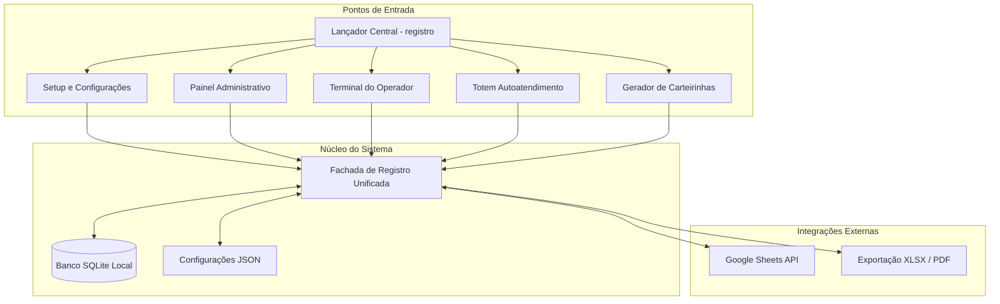

### Perfis de Utilização

| Perfil | Módulos Utilizados | Responsabilidade |
| :--- | :--- | :--- |
| **Administrador / TI** | `setup`, `painel`, `cards` | Configurações do Google Cloud, criação de turmas, importação de alunos, emissão de crachás e relatórios consolidados. |
| **Atendente de Refeitório** | `registrar` | Abertura de sessões diárias, registro assistido de estudantes, conferência de reservas e fechamento de turno. |
| **Estudante / Usuário** | `autoatendimento` | Posicionamento do crachá/QR Code na webcam para validação autônoma instantânea. |

---

## 2. Instalação, Requisitos e Inicialização

### Requisitos Mínimos
- **Sistema Operacional:** Windows 10 ou Windows 11 (64-bit).
- **Processador:** Dual-Core 2.0 GHz ou superior.
- **Memória RAM:** Mínimo de 4 GB (recomendado 8 GB para o Totem com webcam).
- **Dispositivos Opcionais:**
  - Webcam USB ou integrada (resolução mínima 720p) para o Totem.
  - Leitor de código de barras USB (funciona como teclado padrão).
- **Ambiente de Execução:** Python 3.11 a 3.13 com o gerenciador `uv`, ou pacote executável `.exe` distribuído.

### Estrutura de Arquivos e Pastas
A aplicação organiza seus arquivos em diretórios dedicados:
- `./config/`: Contém credenciais Google (`credentials.json`), estado da sessão ativa (`session.json`), ID da planilha (`spreadsheet.json`) e o banco de dados principal (`registro.db`).
- `./logs/`: Arquivos rotativos de registros e diagnóstico (`launcher.log`, `registro.log`, etc.).
- `./backups/`: Cópias de segurança compactadas em formato `.zip`.
- `./docs/`: Documentação e manuais do usuário.

---

## 3. Lançador Central (`registro`)

O **Lançador Unificado** é a porta de entrada principal da aplicação. Ao dar duplo clique no executável ou executar `uv run registro` no terminal sem parâmetros, a janela de menu é apresentada:

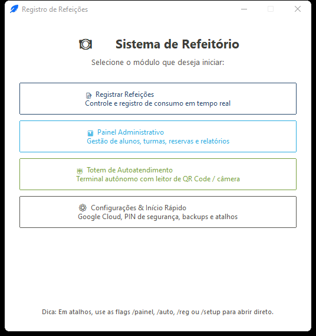

### Elementos da Janela:
1. **📝 Registrar Refeições:** Abre imediatamente o terminal de atendimento manual do operador.
2. **📊 Painel Administrativo:** Abre a central administrativa com abas de discentes, turmas, reservas e métricas.
3. **🤖 Totem de Autoatendimento:** Inicia o terminal autônomo em tela de recepção para leitura de crachás por webcam.
4. **⚙️ Configurações & Início Rápido:** Abre o centro de diagnóstico, PIN, credenciais e ferramentas de backup.
5. **Rodapé com Dicas de Atalho:** Informa como disparar cada módulo diretamente por linha de comando.

> [!TIP]
> **Inicialização Direta por Atalhos do Windows:**
> É possível criar atalhos na Área de Trabalho com argumentos diretos para que cada estação abra seu respectivo módulo:
> - `registro.exe --reg` (ou `/reg`) $\rightarrow$ Abre o **Registro do Operador**
> - `registro.exe --painel` (ou `/painel`) $\rightarrow$ Abre o **Painel Administrativo**
> - `registro.exe --auto` (ou `/auto`) $\rightarrow$ Abre o **Totem de Autoatendimento**
> - `registro.exe --setup` (ou `/setup`) $\rightarrow$ Abre as **Configurações**

---

## 4. Central de Início Rápido e Configurações (`setup`)

A Central de Configurações é o painel de controle técnico do sistema. Ela foi projetada para que qualquer operador ou administrador configure e monitore a saúde do sistema sem precisar editar arquivos de código.

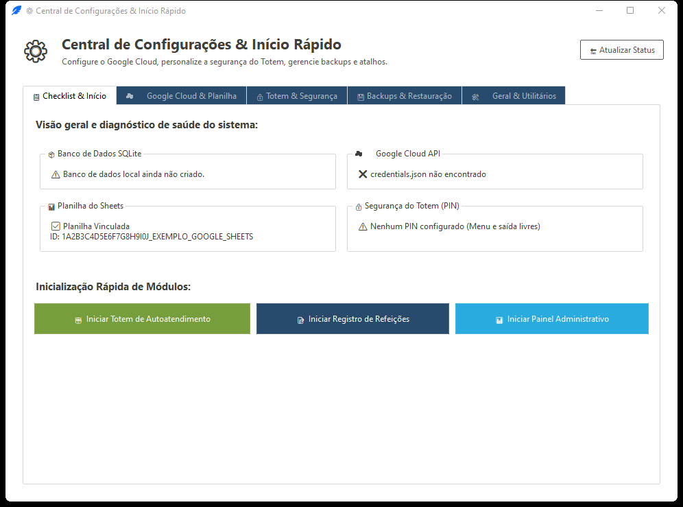

### 4.1 Aba 📋 Checklist & Início
A primeira aba faz um diagnóstico instantâneo do ecossistema:
- **Banco de Dados SQLite:** Indica se o arquivo `registro.db` existe, está acessível e informa o número de alunos e turmas cadastrados.
- **Planilha Google Sheets:** Informa se o arquivo `spreadsheet.json` contém uma planilha configurada.
- **Credenciais da API:** Valida se o arquivo `credentials.json` do Google Cloud está presente e se o `token.json` está autenticado.
- **Segurança do Totem (PIN):** Verifica se o operador já cadastrou um PIN numérico para proteger o Totem.

### 4.2 Aba 🔒 Totem & Segurança e Modal de PIN
Para impedir que alunos ou pessoas não autorizadas fechem o Totem de Autoatendimento ou alterem parâmetros do refeitório, o sistema conta com proteção por PIN numérico touch-friendly:

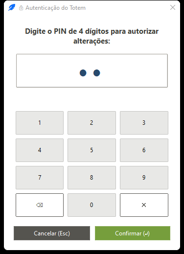

#### Como definir ou alterar o PIN:
1. Acesse a aba **Totem & Segurança**.
2. Clique em **Definir Novo PIN** ou **Alterar PIN**.
3. O teclado numérico em tela se abrirá.
4. Digite a sequência de **4 dígitos** (pelo teclado físico ou clicando nos botões na tela).
5. Clique no botão verde **Confirmar (Enter)**.

### 4.3 Aba ☁️ Google Cloud & Planilha
Permite colar o ID da planilha do Google Sheets (a sequência alfanumérica presente na URL do navegador) e importar o arquivo JSON baixado do Google Cloud Console. Conta com botão de teste de conexão em tempo real.

### 4.4 Aba 💾 Backups & Restauração
- **Criar Backup Agora:** Gera um arquivo `.zip` com data e hora na pasta `./backups/` contendo o banco de dados e as configurações.
- **Restaurar Backup:** Permite selecionar um arquivo `.zip` previamente salvo e restaurar o estado integral do sistema.
- **Limpeza Automática:** Mantém automaticamente as cópias recentes, descartando arquivos mais antigos de acordo com as preferências.

---

## 5. Painel Administrativo (`painel`)

O **Painel Administrativo** é a central de gestão acadêmica e operacional do refeitório. Ele é dividido em abas laterais intuitivas.

### 5.1 Gestão de Estudantes

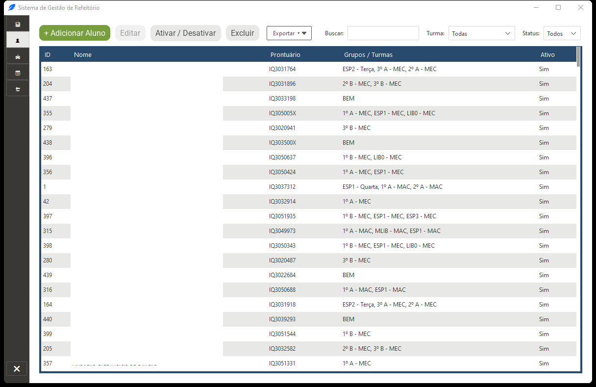

Na aba **Alunos (👤)**, você encontra a relação completa de discentes matriculados:
- **Barra de Busca Superior:** Permite pesquisar instantaneamente por nome ou prontuário/matrícula com busca incremental.
- **Tabela Central:** Exibe ID, Matrícula, Nome, Status (Ativo/Inativo) e as Turmas às quais o estudante pertence.
- **Botões de Ação:**
  - **Adicionar Aluno:** Abre a janela de cadastro de um novo aluno.
  - **Editar Aluno:** Abre o diálogo com os dados do estudante selecionado.
  - **Excluir:** Remove o cadastro do discente selecionado (com confirmação de segurança).
  - **Alternar Status:** Ativa ou desativa temporariamente o estudante sem apagar seu histórico.

#### Diálogo de Adicionar / Editar Aluno
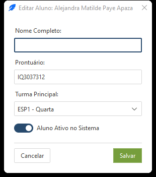

Campos do diálogo:
1. **Nome Completo:** Digite o nome oficial do aluno.
2. **Prontuário / Matrícula:** Código de identificação único (utilizado no QR Code e no leitor).
3. **Turmas / Cursos:** Marque as caixas de seleção correspondentes aos grupos e turmas aos quais o aluno pertence.
4. **Cadastro Ativo:** Checkbox que habilita ou suspende o acesso do estudante ao refeitório.

---

### 5.2 Gestão de Turmas e Cursos

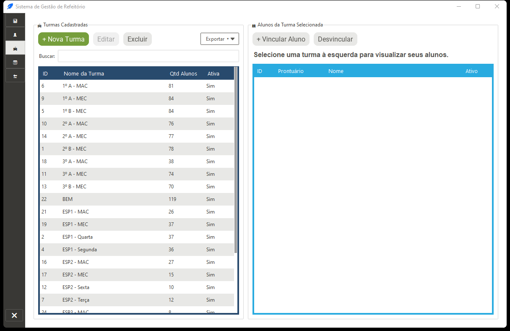

Na aba **Turmas (🏫)**, são gerenciadas as classes, séries e grupos específicos (ex: alunos bolsistas, projetos de extensão, períodos integrais):
- **Tabela de Turmas:** Lista o identificador, nome da turma e a quantidade de estudantes atualmente vinculados.
- **Botão Criar Turma:** Permite registrar uma nova turma no sistema.
- **Botão Editar / Excluir:** Atualiza a nomenclatura ou remove turmas que não possuem registros vinculados.

#### Diálogo de Cadastro de Turma
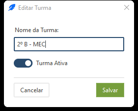

Informe o nome da turma (ex: `1º Ano A - Informática`) e clique em **Salvar**. A turma estará imediatamente disponível para associação de alunos e liberação em sessões de refeição.

---

### 5.3 Controle de Reservas de Refeições

O sistema conta com um módulo robusto de controle de reservas para instituições que exigem agendamento prévio de refeições:

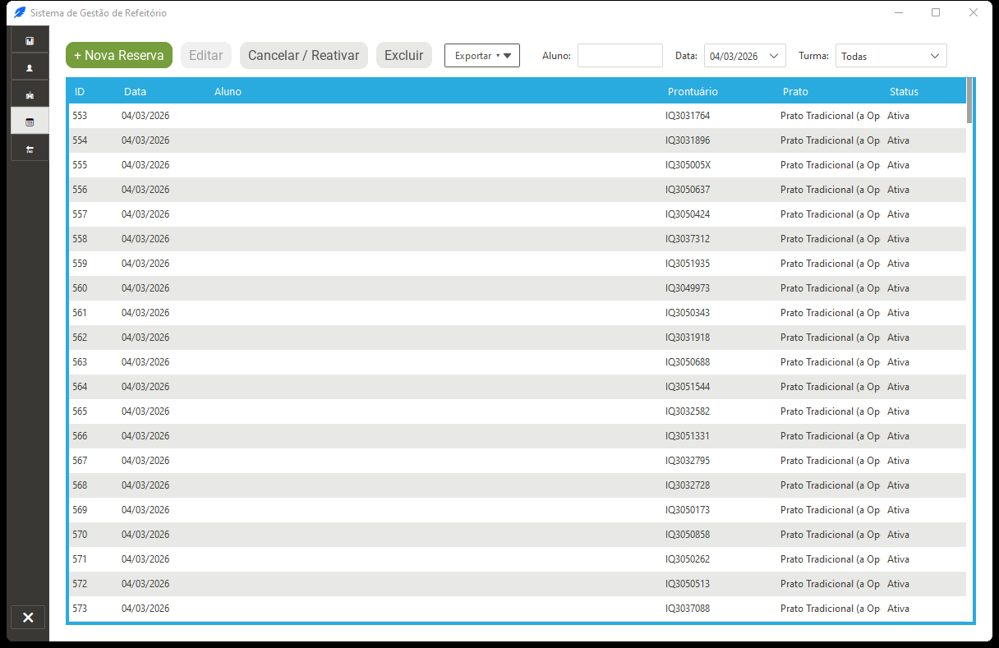

- **Filtro por Data:** Permite visualizar as reservas do dia atual ou de qualquer período selecionado.
- **Status do Consumo:** Informa visualmente se a reserva já foi consumida pelo discente ou se ainda está pendente.
- **Opção de Prato:** Discrimina se o estudante reservou refeição regular, vegetariana, vegana ou dieta especial.

#### Diálogo de Nova Reserva Individual
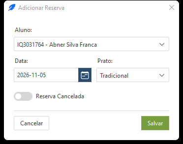

Para cadastrar uma reserva avulsa:
1. Selecione o aluno no menu suspenso ou digite seu nome.
2. Escolha a **Data** da refeição no calendário interativo.
3. Selecione o tipo de **Prato** (Tradicional, Vegetariano, Vegano, etc.).
4. Clique em **Salvar**.

---

### 5.4 Carga em Lote e Importação Inteligente

Para cadastrar centenas de estudantes ou listas diárias de reservas em segundos, o sistema possui a aba **Importação (🔄)**:

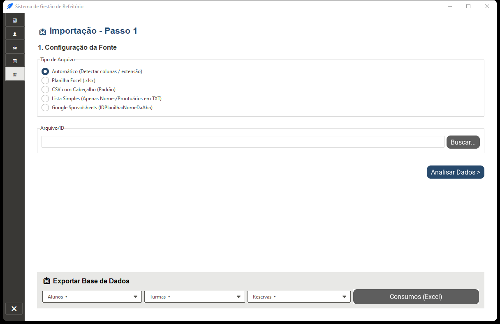

#### Passo a passo para importação:
1. Clique no botão **Selecionar Arquivo** e aponte para sua planilha `.xlsx` ou `.csv`.
2. O sistema realiza uma análise sintática das colunas e exibe um **Preview (Pré-visualização)** dos dados.
3. O assistente inteligente mapeia automaticamente as colunas como *Nome*, *Matrícula*, *Turma* e *Data*.
4. Clique em **Confirmar Carga**: todos os registros são inseridos com verificação de duplicidade e validação de integridade.

---

### 5.5 Dashboard Gerencial e Relatórios

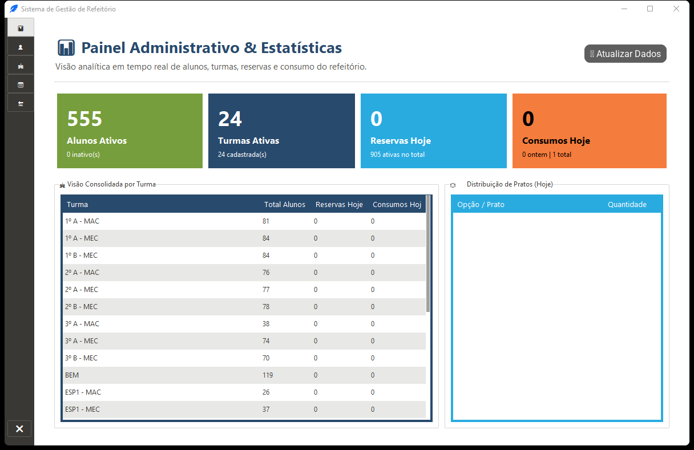

A aba **Dashboard (📊)** transforma os registros em dados visuais estratégicos:
- **Total de Consumos Registrados:** Contagem exata de refeições servidas no período selecionado.
- **Taxa de Comparecimento (%):** Relação entre refeições reservadas e refeições efetivamente consumidas (evita desperdício de comida).
- **Consumo por Turma / Período:** Gráfico de distribuição que aponta os cursos com maior presença.
- **Botão Exportar Relatório (.xlsx):** Gera automaticamente uma planilha Excel formatada na pasta *Documentos* do computador com o detalhamento de cada refeição servida (data, hora exata, aluno, turma e prato).

---

## 6. Terminal de Registro do Operador (`registrar`)

O módulo **Registrar** é a ferramenta de trabalho do atendente ou fiscal do refeitório. Ele permite um fluxo contínuo e ultrarrápido de liberação de alunos durante o horário de almoço ou lanche.

### 6.1 Abertura de Sessão de Refeição
Ao iniciar o módulo, caso nenhuma sessão esteja ativa para o momento, o diálogo de abertura é exibido automaticamente:

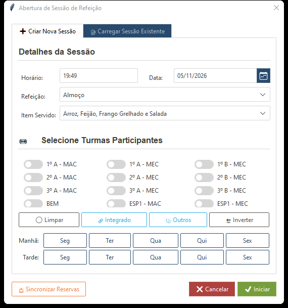

#### Configurações da Sessão:
1. **Refeição:** Selecione *Almoço*, *Lanche da Manhã*, *Lanche da Tarde* ou *Jantar*.
2. **Item Servido:** Descreva o cardápio do dia (ex: *Arroz, Feijão, Frango Grelhado e Salada*).
3. **Data e Horário:** Pré-preenchidos com os dados atuais do computador.
4. **Seleção de Turmas Autorizadas:**
   - Marque as turmas que têm direito à refeição nesta sessão específica.
   - Use os botões rápidos **Marcar Todas**, **Limpar** ou **Inverter** para agilizar a seleção.
5. Clique em **Abrir Sessão**.

---

### 6.2 Operação de Atendimento em Tempo Real

Com a sessão aberta, a tela principal de operação é exibida:

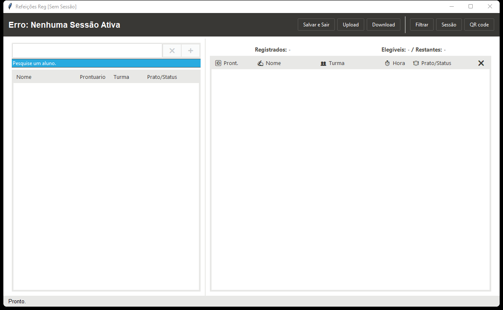

#### Estrutura da Interface:
- **Barra Superior (Cabeçalho):** Exibe a refeição atual (*Almoço*), o item servido, o total de atendimentos realizados e atalhos rápidos de sincronização.
- **Painel Esquerdo (Busca e Validação):**
  - Campo de entrada com foco automático permanente para leitura de código de barras ou digitação.
  - Tabela de estudantes elegíveis que ainda não se alimentaram nesta sessão.
- **Painel Direito (Histórico de Presenças do Dia):**
  - Lista com os últimos estudantes atendidos, contendo hora exata, matrícula, nome e turma.

#### Fluxo de Registro:
1. O estudante apresenta a carteirinha ou informa a matrícula/nome.
2. O operador lê o código com o scanner ou digita as primeiras letras do nome na caixa de busca.
3. O sistema valida instantaneamente:
   - Se o aluno pertence a uma das turmas autorizadas.
   - Se o aluno possui reserva confirmada para hoje.
   - Se o aluno **já consumiu** a refeição nesta mesma sessão (prevenção de dupla refeição).
4. O registro é confirmado com sinal sonoro e feedback visual na tela:

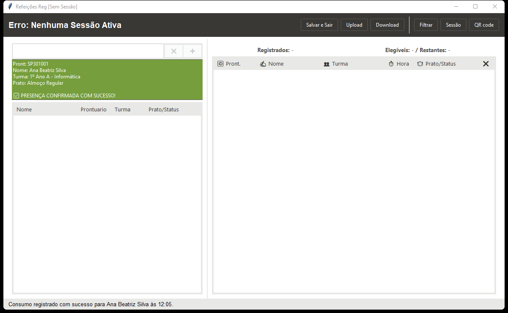

---

### 6.3 Desfazer Registro e Encerramento
- **Desfazer Último Registro:** Se o operador registrar um estudante por engano, basta clicar no botão **Desfazer** na tabela da direita para reverter o lançamento sem alterar os demais registros.
- **Encerrar Sessão:** Ao término do horário de refeição, clique em **Encerrar Sessão**. Os dados locais são consolidados e enviados para a planilha do Google Sheets.

---

## 7. Totem de Autoatendimento (`autoatendimento`)

O **Totem de Autoatendimento** é a solução para refeitórios que utilizam terminais de autoatendimento (com ou sem tela touch), operando de forma autônoma sem necessidade de um operador dedicado.

### 7.1 Identificação por QR Code e Scanner USB

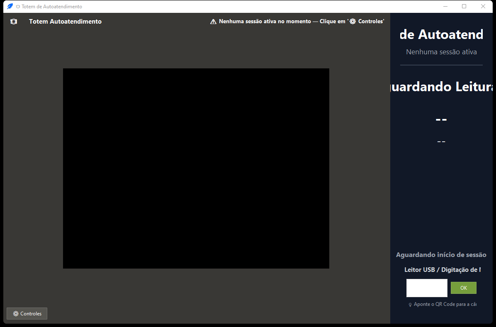

- **Lado Esquerdo:** Exibe a imagem da webcam em tempo real com área delimitada para enquadramento do crachá estudantil.
- **Lado Direito:** Painel de instruções e leitura com feedback de alta legibilidade.
- **Modo Híbrido:** O terminal aceita simultaneamente:
  - Leitura ótica de **QR Code** pela webcam integrada.
  - Leitura por **scanner USB de código de barras**.
  - Digitação manual touch na área inferior para estudantes que esqueceram o crachá físico.

---

### 7.2 Feedback Audiovisual Instantâneo

Assim que a leitura do código ocorre, o Totem responde em fração de segundo alterando a cor de fundo e emitindo som característico:

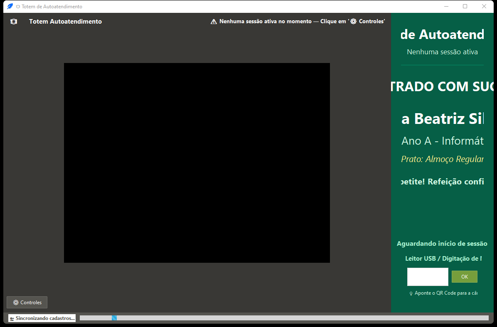

- **Tela Verde (REGISTRADO COM SUCESSO):**
  - Nome completo do estudante em destaque.
  - Turma e prato liberado.
  - Mensagem de acolhimento (*"Bom apetite!"*).
  - Atualização do contador da sessão.
  - A tela retorna automaticamente ao estado de espera após 3 segundos.
- **Tela Vermelha (NÃO AUTORIZADO / JÁ REGISTRADO):**
  - Exibe alerta visual nítido informando o motivo (ex: *"Refeição já registrada para este estudante nesta sessão"* ou *"Estudante não possui reserva para hoje"*).

---

### 7.3 Menu Protegido do Operador no Totem (`F2`)

Para manter a segurança do terminal, o operador do refeitório pode acessar os controles operacionais internos pressionando a tecla <kbd>F2</kbd> ou clicando com o botão direito no cabeçalho:

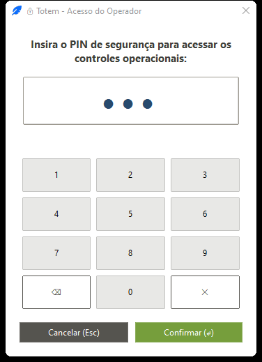

Após digitar o PIN correto de 4 dígitos, o menu administrativo interno é desbloqueado:

#### Consulta de Consumos do Totem
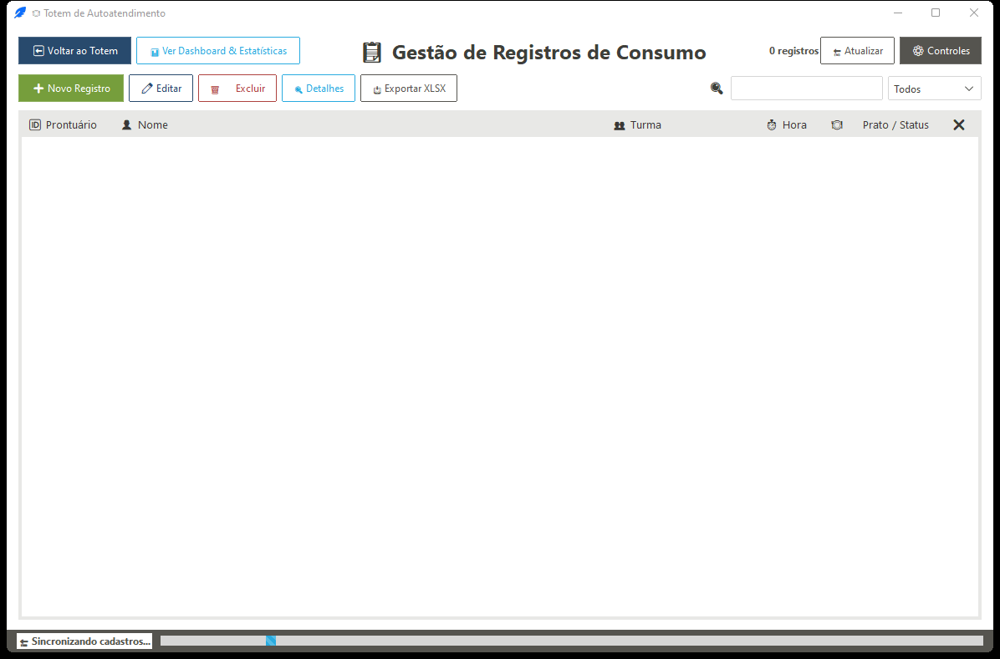
Permite ao fiscal verificar a lista de todos os alunos que passaram pelo totem no dia, com horário exato e opção de cancelamento de passagem indevida.

#### Dashboard Interno do Totem
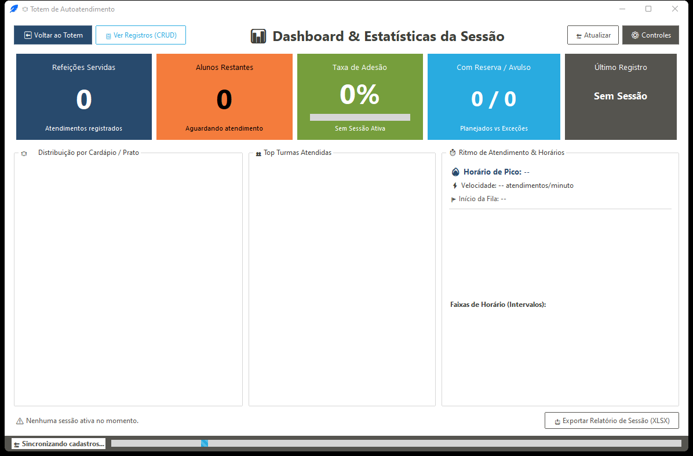
Exibe gráficos e indicadores de fluxo de atendimento minuto a minuto diretamente no terminal.

---

## 8. Gerador de Carteirinhas com QR Code (`cards`)

O sistema inclui o gerador gráfico de crachás estudantis (`registro.cards`), eliminando a necessidade de softwares externos de design gráfico:

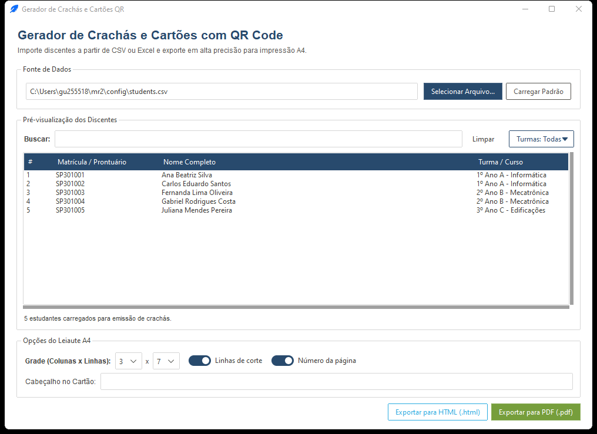

### Recursos do Gerador:
1. **Seleção de Estudantes:** Filtre por turmas específicas ou selecione alunos avulsos.
2. **Configuração de Grade A4:** Escolha o número de colunas (padrão 3) e linhas (padrão 7) por folha de papel.
3. **Marcas de Corte:** Adiciona linhas pontilhadas discretas para guiar o corte com guilhotina ou tesoura.
4. **Exportação Vetorial:**
   - **Gerar PDF:** Produz arquivo `.pdf` pronto para impressão em alta resolução com textos nítidos e QR Codes de alta densidade.
   - **Gerar HTML:** Gera versão web para pré-visualização ou impressão direta pelo navegador.

---

## 9. Rotina Operacional do Dia a Dia (Passo a Passo)

Para garantir uma operação sem imprevistos, siga este roteiro de rotina diária:

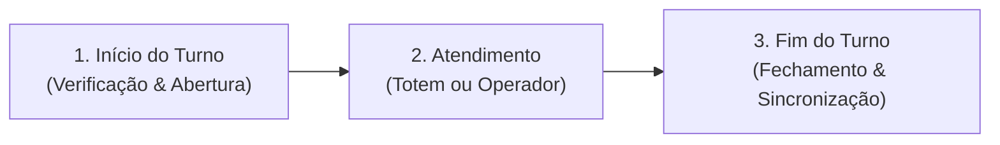

### 🌅 1. Início do Turno (Preparação)
1. Ligue a estação do refeitório e execute o **Lançador Central** (`registro.exe`).
2. Abra as **Configurações** (`--setup`) e verifique se o checklist está verde.
3. Caso a instituição utilize reservas via Google Sheets, abra o **Painel Administrativo** e clique em **Sincronizar com a Nuvem**.
4. Inicie o **Terminal do Operador** (`--reg`) ou o **Totem** (`--auto`).
5. Configure a **Nova Sessão** selecionando a refeição (ex: *Almoço*), o cardápio e conferindo as turmas autorizadas.

### 🍽️ 2. Durante o Serviço (Atendimento)
- **Fluxo Normal:** Os estudantes posicionam a carteirinha no Totem ou apresentam ao atendente. A confirmação visual verde autoriza a retirada da bandeja.
- **Aluno sem crachá:** O atendente pode pesquisar o nome ou matrícula diretamente na busca rápida do terminal do operador.
- **Aluno sem reserva (se aplicável):** O atendente pode avaliar se autoriza a refeição como avulsa ou se cadastra a reserva diretamente no painel.

### 🌇 3. Fim do Turno (Consolidação)
1. No terminal do operador, clique em **Encerrar Sessão**.
2. Clique no botão **Sincronizar Google Sheets** para enviar os dados para a planilha da diretoria/nutrição.
3. Na central de configurações, clique em **Criar Backup Agora** para arquivar os registros do dia com segurança.

---

## 10. Tabela de Atalhos de Teclado

Os principais atalhos foram padronizados para garantir agilidade no atendimento:

| Atalho | Módulo | Ação Executada |
| :--- | :--- | :--- |
| <kbd>F2</kbd> | Totem | Abre o diálogo de PIN para acesso ao menu do operador |
| <kbd>F5</kbd> | Painel / Setup | Atualiza tabelas e status dos diagnósticos |
| <kbd>F11</kbd> | Totem | Alterna o modo de Tela Cheia (Fullscreen) |
| <kbd>Esc</kbd> | Geral | Fecha janelas modais e diálogos abertos |
| <kbd>Ctrl</kbd> + <kbd>F</kbd> | Operador / Painel | Coloca o foco imediato no campo de busca de alunos |
| <kbd>Ctrl</kbd> + <kbd>Z</kbd> | Operador | Desfaz o último registro de refeição lançado |
| <kbd>Enter</kbd> | Modais | Confirma ações nos diálogos e formulários |

---

## 11. Guia de Solução de Problemas (Troubleshooting)

### A webcam não liga no Totem de Autoatendimento
> [!WARNING]
> - Verifique se a webcam não está sendo usada por outro aplicativo (Teams, Zoom, Câmera do Windows).
> - Na Central de Configurações (`--setup`), verifique o **Índice da Câmera** (geralmente `0` para integrada ou `1` para USB externa).
> - Lembre-se de que o **Leitor USB de Código de Barras** continua funcionando mesmo se a câmera estiver desligada!

### Mensagem "Erro de Autenticação com a Planilha Google"
> [!NOTE]
> - Verifique se o computador possui acesso à internet.
> - Certifique-se de que o arquivo `credentials.json` está salvo na pasta `./config/`.
> - Verifique se a planilha no Google Drive foi compartilhada com permissão de **Editor** com o e-mail da conta de serviço (o endereço presente dentro do arquivo `credentials.json`).

### Esqueci o PIN do Operador do Totem
> [!IMPORTANT]
> - Abra a Central de Configurações executando: `registro.exe --setup`.
> - Vá na aba **Totem & Segurança** e clique em **Redefinir PIN**. O sistema permitirá a definição de uma nova senha numérica.

### Desejo restaurar o sistema em outro computador
> [!TIP]
> 1. Copie o arquivo `.zip` mais recente da pasta `./backups/` do computador antigo.
> 2. No novo computador, abra o executável com a flag `--setup`.
> 3. Vá na aba **Backups & Restauração**, clique em **Restaurar Backup** e selecione o arquivo. Todos os alunos, turmas e históricos estarão prontos para uso.

---

*Manual elaborado de acordo com a versão 1.2.2 do Sistema de Registro de Refeições. Todos os dados das capturas de tela são demonstrativos e aderentes às diretrizes da LGPD.*

