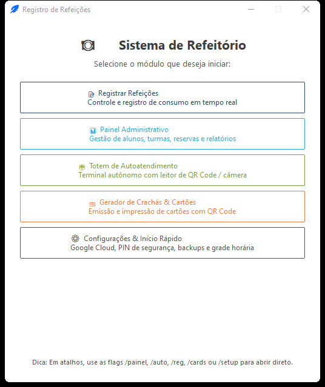

# Capítulo 1 — Visão Geral, Arquitetura e Inicialização

O **Sistema de Controle de Refeitório (MR2)** — versão **1.3.0** — é uma suíte integrada de aplicativos desktop desenvolvida para gerenciar com segurança, rapidez e rastreabilidade todo o ciclo de alimentação escolar: cadastro de discentes, reservas de refeições, controle de acesso por grade horária e cotas diárias, emissão de crachás com QR Code e sincronização bidirecional com o Google Sheets.

[⬅️ Voltar ao Índice do Manual](../MANUAL_DO_USUARIO.md) | [Próximo: Capítulo 2 — Configuração Inicial e Setup ➡️](./02_configuracao_inicial_e_setup.md)

---

## 1.1 Os Cinco Módulos do Sistema

Ao abrir o aplicativo sem parâmetros de linha de comando, a janela inicial (**Menu Principal**) apresenta os 5 módulos que compõem o ecossistema:

| Botão no Menu | Módulo | Finalidade Principal | Público-Alvo |
| :--- | :--- | :--- | :--- |
| **📝 Registrar Refeições** | Terminal do Operador (`Registrar`) | Controle assistido da fila em tempo real, abertura/edição de sessões, aplicação de filtros por turma, exceções (`#`), `Horário Livre` e `Bypass`, além de estornos auditados. | Operadores de caixa / portaria do refeitório |
| **📊 Painel Administrativo** | Painel (`Painel`) | Cadastro e manutenção de alunos, turmas e categorias (`PAP`, etc.), reservas individuais, assistente de importação em 4 passos, exportações e dashboard gerencial. | Nutricionistas, CAE e equipe administrativa |
| **🤖 Totem de Autoatendimento** | Totem (`Autoatendimento`) | Quiosque autônomo para o próprio estudante apresentar o crachá QR Code na câmera ou passar no leitor de código de barras USB, com barra de horários, CRUD de consumos e dashboard da sessão. | Estudantes (fila autônoma) e supervisão via PIN |
| **💳 Gerador de Crachás & Cartões** | Crachás (`Cards`) | Leitura do banco SQLite ou planilhas CSV/Excel para diagramação A4 e impressão de crachás com QR Code em PDF vetorial ou HTML. | Equipe administrativa / secretaria |
| **⚙️ Configurações & Início Rápido** | Setup (`Setup`) | Checklist de prontidão do ambiente, conexão com Google Cloud/Sheets, criação automática das abas da planilha, configuração de PIN/Totem/Áudio, editor visual da Grade Horária semanal, backups `.zip` e utilitários. | Responsável técnico / administrador local |

> **Fluxo recomendado de implantação:**  
> **1. Setup** (conectar planilha e definir grade/PIN) ➡️ **2. Painel** (importar ou cadastrar alunos e reservas) ➡️ **3. Crachás** (gerar cartões QR) ➡️ **4. Operador e/ou Totem** (atendimento diário na fila).

---

## 1.2 Inicialização por Atalhos e Linha de Comando

Todos os módulos compartilham o mesmo núcleo e banco de dados. Você pode iniciar o sistema pelo menu gráfico ou ir direto a um módulo específico usando atalhos de desktop, scripts ou terminal.

### Comandos dedicados (instalados no ambiente Python / `uv run`)

| Comando | Módulo Aberto |
| :--- | :--- |
| `registro` | Abre o **Menu Inicial** (ou interpreta uma flag opcional) |
| `registrar` | Abre diretamente o **Terminal do Operador** |
| `painel` | Abre diretamente o **Painel Administrativo** |
| `autoatendimento` | Abre diretamente o **Totem de Autoatendimento** |
| `cards` | Abre diretamente o **Gerador de Crachás & Cartões** |
| `setup` | Abre diretamente a **Central de Configurações & Início Rápido** |

### Flags aceitas pelo executável principal (`registro` / `python -m registro`)

Todas as variações abaixo (com `--`, `/`, `-` ou sem prefixo) são reconhecidas sem diferenciação de maiúsculas/minúsculas:

* **Terminal do Operador**: `--reg`, `/reg`, `-reg`, `reg`, `--registrar`, `/registrar`, `registrar`
* **Painel Administrativo**: `--painel`, `/painel`, `-painel`, `painel`
* **Totem de Autoatendimento**: `--auto`, `/auto`, `-auto`, `auto`, `--autoatendimento`, `/autoatendimento`, `autoatendimento`
* **Gerador de Crachás**: `--cards`, `/cards`, `-cards`, `cards`, `--crachas`, `/crachas`
* **Setup / Configurações**: `--setup`, `/setup`, `-setup`, `setup`, `--config`, `/config`, `-config`, `config`, `--quickstart`, `/quickstart`, `quickstart`
* **Ajuda de linha de comando**: `--help`, `/help`, `-h`, `/?`, `help`

> 💡 **Dica para Windows:** Crie atalhos diferentes na Área de Trabalho apontando para o mesmo executável e adicione `/auto` no destino do computador do quiosque ou `/reg` no computador do atendente.

---

## 1.3 Arquitetura de Dados e Pastas do Sistema

O sistema funciona de modo **offline-first**: todas as leituras de atendimento (fila no Terminal ou no Totem) ocorrem instantaneamente contra o banco local SQLite, garantindo que instabilidades de internet não interrompam a entrega das refeições. A sincronização com o Google Sheets complementa o fluxo trazendo novos cadastros/reservas e enviando consumos e estornos.

### Arquivos e diretórios gerenciados automaticamente

| Caminho | Função |
| :--- | :--- |
| `config/registro.db` | Banco de dados relacional SQLite principal (estudantes, grupos, reservas, sessões, consumos ativos/cancelados e `SyncLog`). Utiliza modo WAL (`-wal` e `-shm` temporários durante uso). |
| `config/settings.json` | Configurações de segurança (hash PBKDF2 + salt do PIN do operador), preferências do Totem e parâmetros de áudio. |
| `config/grade_horarios.json` | Grade semanal (segunda a domingo) com janelas de horário por refeição (`almoco`, `jantar`, `lanche`), turmas e categorias. |
| `config/lanches.json` | Catálogo de opções de lanche exibido ao criar sessões do tipo **Lanche**. |
| `config/presets_turmas.json` | Predefinições de turmas organizadas por turno/dia (`manha`/`tarde`, `seg`..`sex`). |
| `config/turmas_integrado.json` | Lista das turmas pertencentes ao Ensino Médio Integrado usada pelo atalho **🔗 Integrado** nos filtros. |
| `config/mapeamento_colunas.json` | Tabela de tradução de cabeçalhos externos de planilhas para nomes internos de colunas. |
| `config/session.json` | Estado persistido da sessão ativa (`id_sessao`, lista `excecao_grupos` e flag `ignorar_horario_grade`). |
| `config/spreadsheet.json` | Identificador (`spreadsheet_id`) da planilha do Google Sheets vinculada. |
| `config/credentials.json` | Credencial OAuth2 Desktop ou Conta de Serviço (*Service Account*) baixada do Google Cloud. |
| `config/token.json` | Token de autorização renovável gerado automaticamente após o primeiro login OAuth2 bem-sucedido. |
| `config/students.csv` / `config/reserves.csv` | Cache local dos últimos dados baixados das abas `Discentes` e `DB` do Google Sheets (também usado como fonte padrão opcional no Gerador de Crachás). |
| `backups/` | Pacotes `.zip` completos do diretório `config/` (criados manualmente ou de forma automática antes de restaurações e redefinições). |
| `logs/` | Arquivos de log por módulo (`<nome_app>.log`) com rotação automática ao atingir **5 MB** (mantendo até **5** backups históricos) e captura global de exceções não tratadas. |

---

[⬅️ Voltar ao Índice do Manual](../MANUAL_DO_USUARIO.md) | [Próximo: Capítulo 2 — Configuração Inicial e Setup ➡️](./02_configuracao_inicial_e_setup.md)

