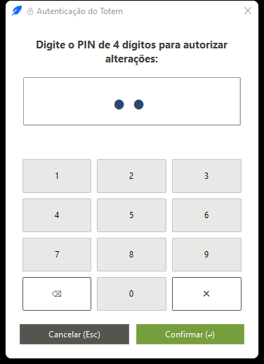
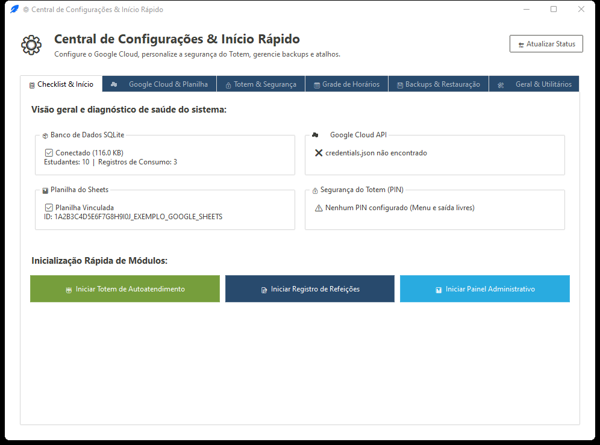
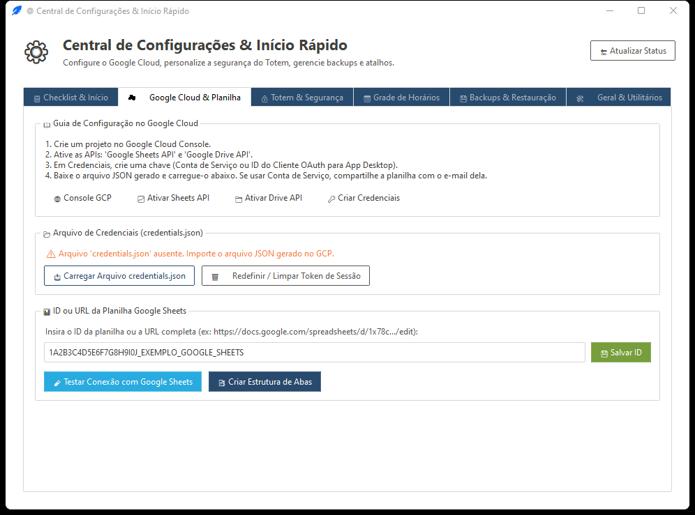
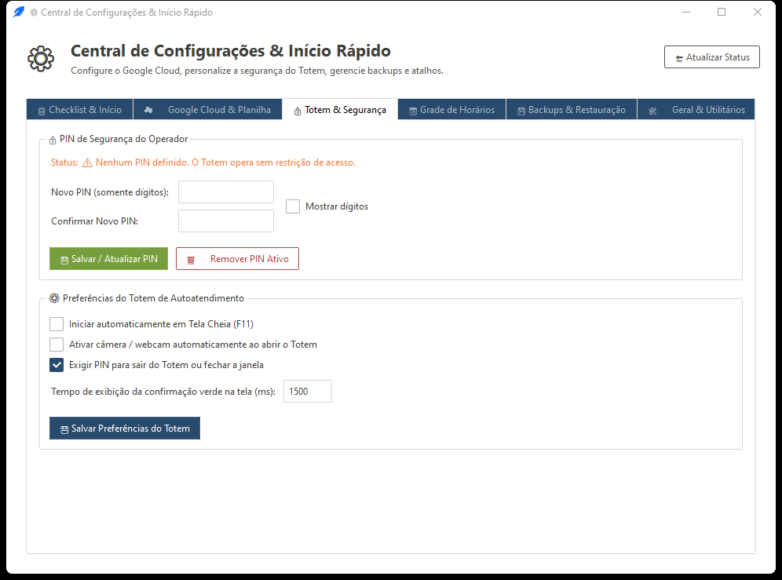
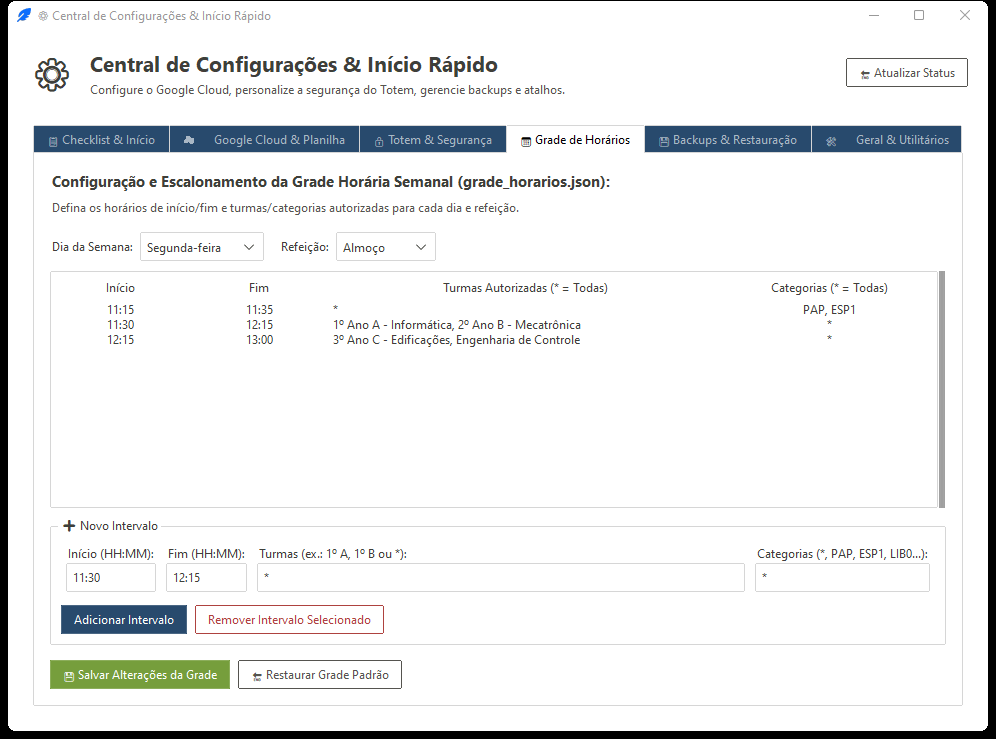
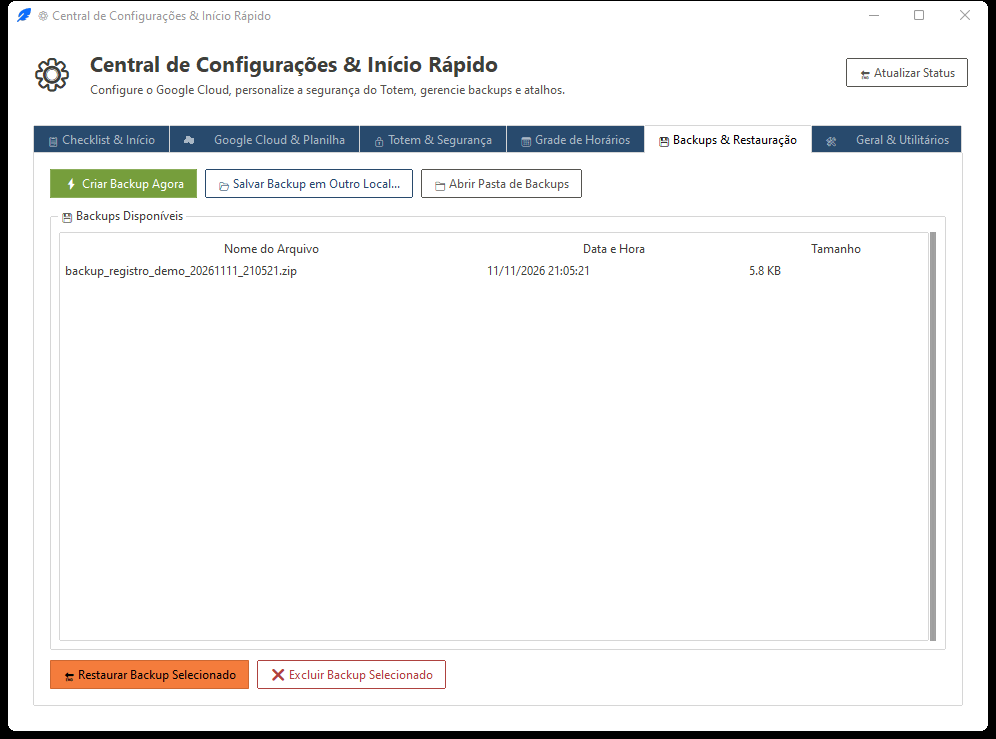
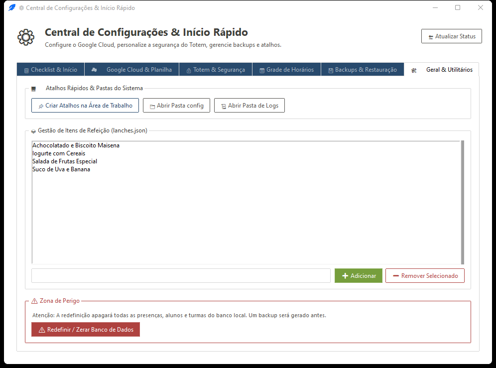

# Capítulo 2 — Configuração Inicial e Setup (`Configurações & Início Rápido`)

A **Central de Configurações & Início Rápido** (`setup` / `--setup`) centraliza toda a preparação do ambiente, credenciais de nuvem, políticas de segurança por PIN, editor visual da grade de horários semanal, cópias de segurança e utilitários do catálogo.

[⬅️ Capítulo 1 — Visão Geral](./01_visao_geral_e_arquitetura.md) | [📑 Índice](../MANUAL_DO_USUARIO.md) | [Capítulo 3 — Painel Administrativo ➡️](./03_painel_administrativo.md)

---

## 2.1 Segurança por PIN nas Alterações

Se você já tiver definido um **PIN numérico** (de 4 a 12 dígitos), o Setup exige autenticação prévia por segurança antes de aplicar operações sensíveis, como alterar configurações do Totem/PIN, restaurar ou excluir backups ou redefinir o banco de dados.

* **Como digitar:** Clique nos botões da tela (*touchscreen*) ou utilize o teclado físico (`0`–`9`, `BackSpace`/`⌫` para apagar, `Enter` para confirmar, `Esc` para cancelar).
* **Sem PIN configurado:** Se o sistema ainda não possuir PIN cadastrado (`pin_hash` vazio em `config/settings.json`), nenhuma solicitação de senha será exibida.

---

## 2.2 Aba 1 — 📋 Checklist & Início

A primeira aba fornece um diagnóstico instantâneo do ambiente antes de iniciar o atendimento.

### Os 5 Cartões de Diagnóstico

1. **📦 Banco de Dados SQLite:** Verifica se `config/registro.db` está criado e acessível.
2. **☁️ Google Cloud API:** Indica se `config/credentials.json` foi localizado (e se já há `config/token.json` ou Conta de Serviço configurada).
3. **📊 Planilha Vinculada:** Mostra se há um `spreadsheet_id` válido salvo em `config/spreadsheet.json`.
4. **🔐 PIN de Segurança do Totem:** Informa se a proteção por PIN está **Ativa** ou **Não Configurada**.
5. **💾 Backup e Integridade:** Contabiliza quantos arquivos `.zip` existem atualmente na pasta `backups/`.

### Botões da Aba
* **🔄 Atualizar Status** (no topo direito da janela): Recarrega todos os cartões e indicadores.
* **Botões de Início Rápido** (rodapé da aba): Permitem lançar diretamente os módulos operacionais após concluir os ajustes, além de avançar rapidamente para abas pendentes do próprio checklist.

---

## 2.3 Aba 2 — ☁️ Google Cloud & Planilha

Esta aba prepara a sincronização bidirecional com uma planilha do Google Sheets.

### Parte 1: Credenciais da API (`credentials.json`)
O sistema aceita dois tipos oficiais de arquivo JSON gerados no Google Cloud Console (com a **Google Sheets API** habilitada):

* **OAuth 2.0 (ID de cliente para computador / Desktop App):**
  1. Clique em **Selecionar credentials.json...** para copiar o arquivo escolhido para `config/credentials.json`.
  2. Clique em **Testar Login OAuth** para abrir o navegador padrão e autorizar sua conta Google. O sistema gravará `config/token.json` para autenticações futuras sem novo login manual.
* **Conta de Serviço (`service_account`):**
  1. Importe o JSON da Conta de Serviço em **Selecionar credentials.json...**.
  2. Nesse modo **não há login pelo navegador** nem `token.json`; basta compartilhar a planilha do Google Sheets (com permissão de **Editor**) com o endereço `client_email` presente no JSON.

### Parte 2: Vínculo e Estrutura da Planilha (`spreadsheet.json`)
1. Cole no campo da planilha a **URL completa** do Google Sheets (ex.: `https://docs.google.com/spreadsheets/d/1ABC.../edit`) ou apenas o **ID** (`1ABC...`). O sistema extrai o identificador automaticamente.
2. Clique em **Salvar Planilha**.
3. Clique em **Criar Estrutura de Abas** para validar ou montar automaticamente todas as 8 abas esperadas na planilha conectada:
   * `Discentes`, `DB`, `Almoço`, `Jantar`, `Lanche`, `Consumo_Cancelados`, `Configuração` e `Lanches`.
   * **Comportamento seguro:** Se uma aba não existir, ela é criada com o cabeçalho padronizado em **negrito** e a **1ª linha congelada**. Se a aba já existir e estiver vazia, o cabeçalho é inserido; se já contiver dados, é preservada intacta sem sobrescrita.

> 📖 Consulte o [Capítulo 4 — Regras de Negócio e Integração](./04_regras_de_negocio_e_integracao.md) para ver o esquema exato de colunas de cada uma das 8 abas.

---

## 2.4 Aba 3 — 🔒 Totem & Segurança

Controla a trava de saída/menus do Totem, exibição inicial da câmera e sinalização sonora.

### Segurança e PIN do Operador
* **Definir / Alterar PIN:** Informe um código numérico entre **4 e 12 dígitos**. O sistema nunca salva a senha em texto puro — armazena apenas um derivado criptográfico (`PBKDF2-HMAC-SHA256` com salt aleatório) em `config/settings.json`.
* **Remover PIN:** Desativa a exigência de senha nos controles do Totem e no Setup (exige confirmação com o PIN atual caso já esteja ativo).

### Preferências do Totem (`totem` em `settings.json`)
| Opção | Padrão | Efeito Prático |
| :--- | :--- | :--- |
| **Iniciar em Tela Cheia (`fullscreen`)** | Desmarcado (`false`) | Quando ativado, abre o Totem cobrindo toda a tela e ocultando barras do sistema (`F11` / `Esc` continuam funcionando para sair/alternar). |
| **Ligar Câmera ao Iniciar (`camera_on_start`)** | Marcado (`true`) | Inicia a webcam automaticamente na abertura do Totem para leitura contínua de QR Code. Desmarque se utilizar apenas leitor de código de barras USB ou digitação. |
| **Exigir PIN para Sair/Menus (`require_pin_to_exit`)** | Marcado (`true`) | Protege o menu `⚙️ Controles` (`F2`/`Ctrl+M`/botão direito) e o fechamento da janela do Totem quando houver um PIN cadastrado. |
| **Tempo de Feedback em ms (`feedback_delay_ms`)** | `1500` ms | Tempo em milissegundos em que a tela verde (sucesso) ou vermelha (erro) e a borda na câmera permanecem visíveis antes de voltar ao estado `Aguardando QR Code...`. |
| **Índice da Câmera (`camera_index`)** | `0` | Índice OpenCV do dispositivo de vídeo (`0` para webcam principal/integrada; `1`, `2`, etc. se houver mais de uma câmera conectada). |

### Áudio e Bips (`audio` em `settings.json`)
* **Habilitar Feedback Sonoro (`habilitado`)**: Ativa ou silencia os bips de confirmação e alerta.
* **Frequências e Durações**: Permite ajustar no Windows os valores de `winsound.Beep` (padrão: **Sucesso = 1000 Hz por 200 ms**; **Erro = 400 Hz por 1000 ms**). Em Linux/Unix utiliza o alerta nativo do sistema (`bell()`).
* **Testar Som:** Dispara os bips configurados para conferir o volume antes de colocar o Totem no refeitório.
* **Salvar Configurações:** Persiste todas as alterações da aba em `config/settings.json`.

---

## 2.5 Aba 4 — 📅 Grade de Horários

Define as faixas oficiais de atendimento por **dia da semana** e **refeição**. O editor manipula diretamente o arquivo `config/grade_horarios.json`.

### Como Configurar os Slots
1. Selecione o **Dia da Semana** (`segunda` a `domingo`) e a **Refeição** (`almoco`, `jantar` ou `lanche`).
2. Na grade listada, cada faixa (*slot*) contém 4 campos:
   * **Início (`HH:MM`)** e **Fim (`HH:MM`)**: janela principal da faixa (ex.: `11:30` até `12:10`). Na validação real, o sistema aplica automaticamente **±5 minutos de tolerância**.
   * **Turmas autorizadas**: nomes exatos de turmas separados por vírgula (ex.: `1º A - MAC, 1º A - MEC`) ou coringa **`*`** (ou `Todas`) para não restringir por turma.
   * **Categorias autorizadas**: nomes de categorias separados por vírgula (ex.: `PAP, ESP1`) ou coringa **`*`** (ou `Todas`).
3. Use os botões da aba para **Adicionar Faixa**, **Editar/Atualizar**, **Remover Faixa**, **Copiar Dia** (quando disponível) e **Salvar Grade**.

> ⚠️ **Regra de avaliação de Turmas × Categorias e Fallback:**  
> * Se um horário restringe **apenas Turmas** (e Categorias = `*`), só alunos daquelas turmas entram na faixa.  
> * Se restringe **apenas Categorias** (e Turmas = `*`), só alunos com aquelas categorias entram na faixa (ideal para atendimento prioritário de `PAP` às 11:15, por exemplo).  
> * Se **ambos** tiverem restrições específicas, aplica-se a regra **OU**: entra quem pertencer à turma listada **OU** possuir a categoria listada.  
> * Se **não existir nenhum slot** para um determinado `dia + refeição`, a trava horária fica liberada (fallback para grupos da sessão).  
> * Atenção ao sincronizar com a nuvem: se a aba **`Configuração`** do Google Sheets tiver faixas válidas, o download de dados sobrescreverá `grade_horarios.json`.

---

## 2.6 Aba 5 — 💾 Backups & Restauração

Ferramenta de segurança para proteger todo o diretório `config/` (banco SQLite `registro.db` e todos os JSONs/CSVs de configuração).

* **Criar Backup Agora:** Executa automaticamente um *checkpoint WAL* no SQLite (garantindo que nenhuma transação em memória fique de fora), compacta todo o conteúdo de `config/` em `backups/backup_registro_YYYYMMDD_HHMMSS.zip` (ignorando arquivos temporários `.tmp`, `.lock`, `-wal` e `-shm`) e atualiza a lista.
* **Restaurar Selecionado:**
  * Solicita confirmação (e PIN, se configurado).
  * Antes de extrair o backup escolhido, cria automaticamente um ponto de retorno de segurança com prefixo **`backup_pre_restauracao_...zip`**.
  * Protege contra caminhos maliciosos (*zip-slip*) durante a extração.
* **Excluir Selecionado:** Remove permanentemente o arquivo `.zip` da pasta `backups/` após confirmação.
* **Redefinir Banco de Dados (Área Crítica):**
  * Exige dupla confirmação e gera automaticamente um backup preventivo **`backup_pre_redefinicao_...zip`** antes de zerar `registro.db`, recriando a estrutura limpa de tabelas.

---

## 2.7 Aba 6 — 🛠️ Geral & Utilitários

Agrupa atalhos de manutenção do ambiente e edição rápida das listas auxiliares em JSON.

* **Gerenciar Cardápio de Lanches (`config/lanches.json`):** Permite adicionar ou remover descrições de lanches pré-cadastradas que aparecem no combo de criação/edição de sessões do tipo **Lanche**.
* **Turmas do Integrado (`config/turmas_integrado.json`):** Edita a lista de turmas considerada pelo botão rápido **🔗 Integrado** nos diálogos de sessão e filtro.
* **Acesso Rápido às Pastas:** Botões para abrir diretamente no explorador de arquivos do sistema operacional os diretórios de **Configuração (`config/`)**, **Logs (`logs/`)** e **Backups (`backups/`)** — muito útil para inspecionar `<app>.log` em caso de suporte técnico.

---

[⬅️ Capítulo 1 — Visão Geral](./01_visao_geral_e_arquitetura.md) | [📑 Índice](../MANUAL_DO_USUARIO.md) | [Capítulo 3 — Painel Administrativo ➡️](./03_painel_administrativo.md)

