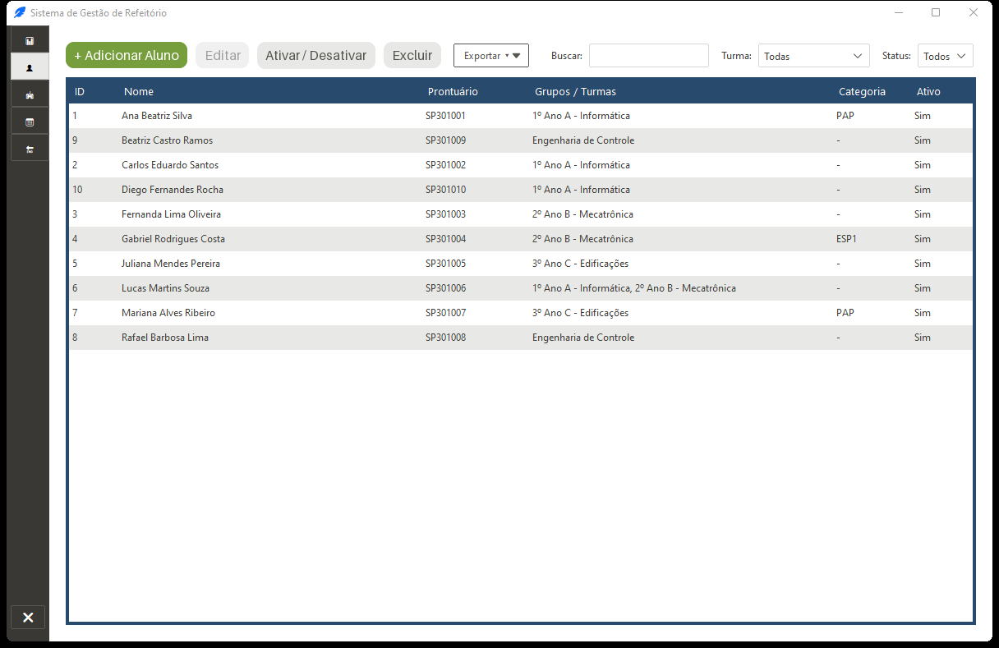
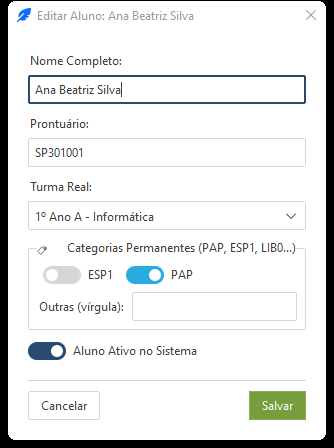
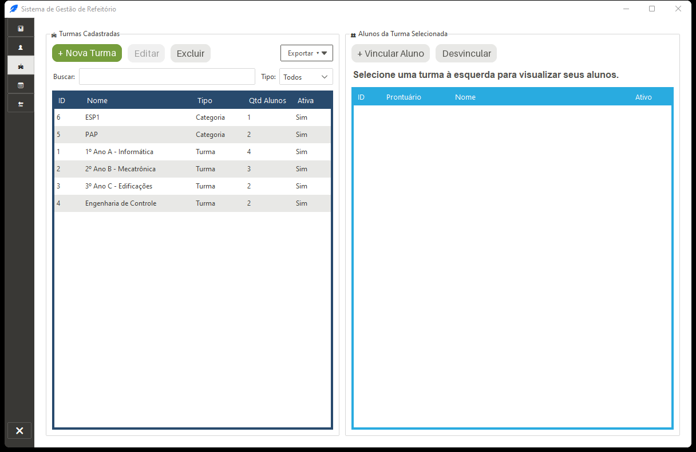
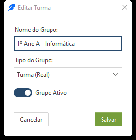
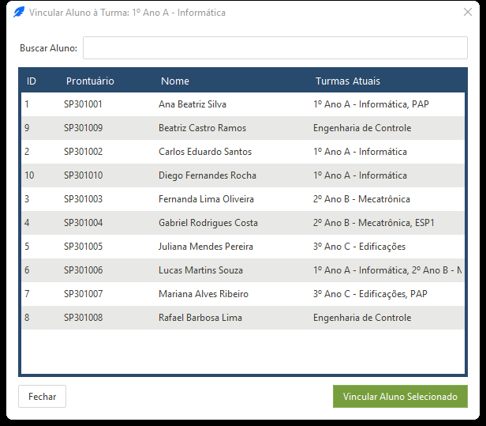
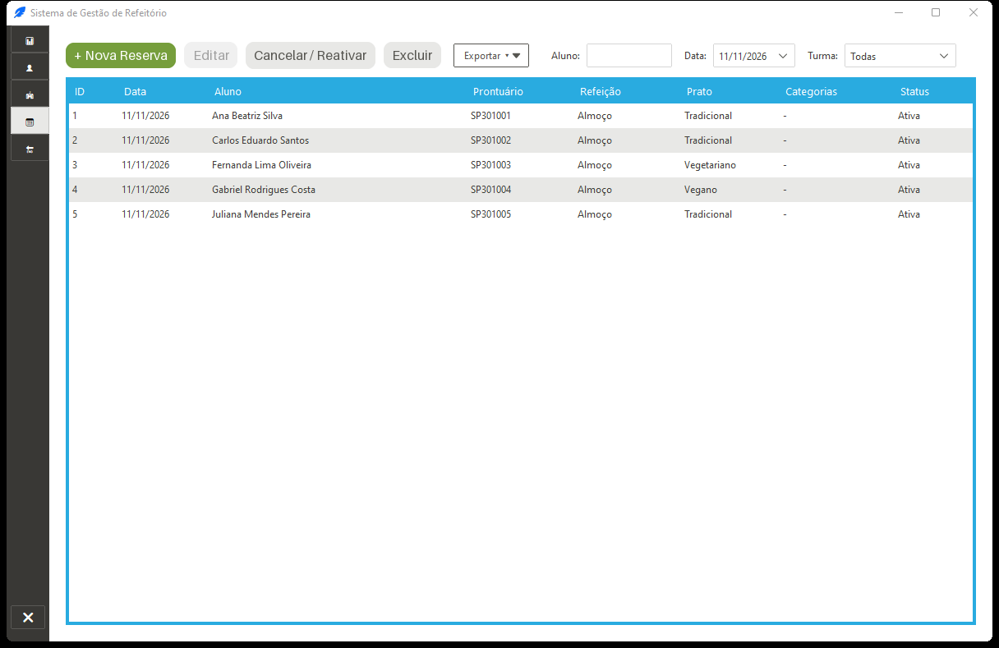
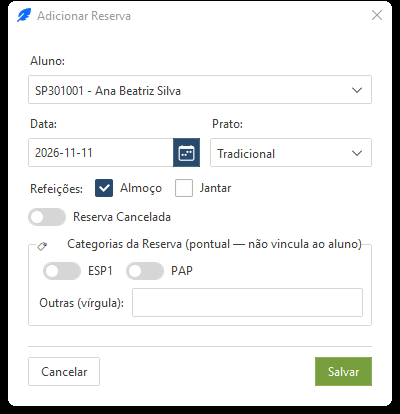
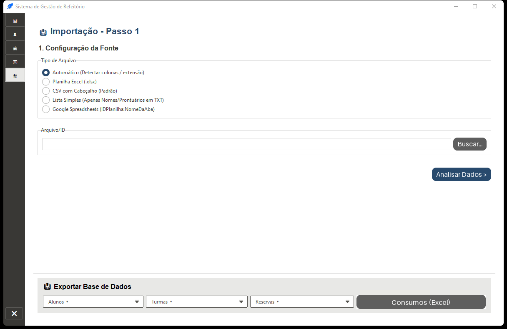
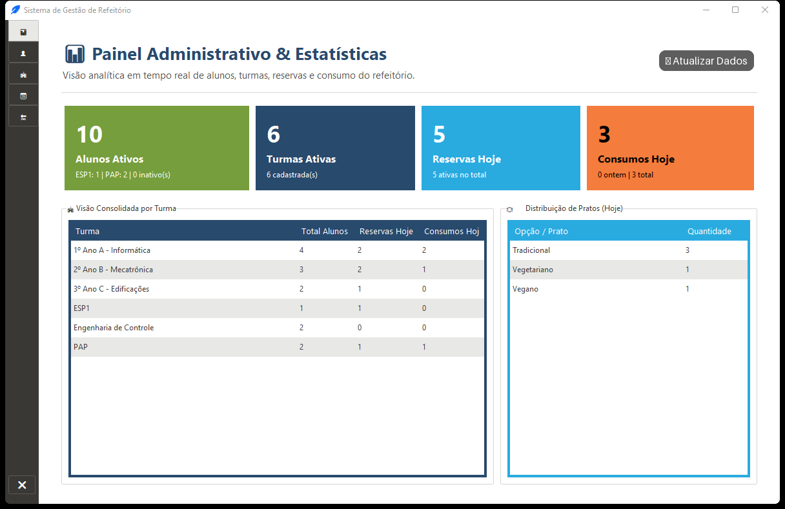

# Capítulo 3 — Painel Administrativo (`Painel`)

O **Painel Administrativo** (`painel` / `--painel`) é a retaguarda de gestão do sistema. A navegação lateral esquerda dá acesso às **5 seções principais** (`📊`, `👤`, `🏫`, `📅`, `🔄`) e ao botão de saída (`❌`).

[⬅️ Capítulo 2 — Configuração e Setup](./02_configuracao_inicial_e_setup.md) | [📑 Índice](../MANUAL_DO_USUARIO.md) | [Capítulo 4 — Regras de Negócio e Integração ➡️](./04_regras_de_negocio_e_integracao.md)

---

## 3.1 Conceito-Chave: Turmas Reais vs. Categorias

Em todo o Painel Administrativo e na lógica de acesso do refeitório, os grupos são divididos em dois tipos distintos:

1. **Turma (Real):** A classe/curso oficial do aluno (ex.: `1º Ano A - Informática`, `Engenharia de Controle`).
2. **Categoria (Optativa / Programa / Evento):** Marcadores ou programas vinculados ao estudante de forma **permanente** (no cadastro do aluno) ou **pontual** (apenas em uma reserva de data específica), como `PAP` (Programa de Assistência Estudantil), `ESP1` ou `LIB0`.

> 💡 Marcadores vazios ou legados como `-`, `N/A`, `REGULAR`, `none`, `null` ou `nenhuma` são descartados automaticamente na importação e normalização — um aluno sem tags especiais simplesmente não possui categorias listadas.

---

## 3.2 Aba 👤 Alunos

Gerencia todo o corpo discente, seus vínculos de turma, categorias permanentes e estado ativo/inativo.

### Barra de Ações e Filtros
* **+ Adicionar Aluno** / **Editar** (ou **duplo clique** na linha): Abre o formulário `StudentDialog`.
* **Ativar / Desativar:** Alterna rapidamente o status `Ativo` sem apagar histórico. **Atenção:** alunos marcados como **Inativos** não aparecem nas listas de elegíveis e são bloqueados automaticamente tanto no Terminal do Operador quanto no Totem (mesmo com Bypass).
* **Excluir:** Executa exclusão com verificação de integridade referencial:
  * Se o aluno **não tiver** nenhuma reserva ou consumo histórico, é excluído permanentemente do banco.
  * Se o aluno **possuir histórico** de reservas ou consumos, a exclusão física é bloqueada para preservar os relatórios e o sistema pergunta se deseja apenas **desativá-lo** (*soft-delete fallback*).
* **Exportar ▾ (XLSX / CSV):** Exporta exatamente os alunos atualmente exibidos conforme os filtros ativos na tela.
* **Filtros:** Campo **Buscar** (por nome ou prontuário), seletor **Turma** (`Todas` ou grupo específico) e seletor **Status** (`Todos`, `Ativos`, `Inativos`).
* **Ordenação:** Clique em qualquer cabeçalho de coluna da tabela (`ID`, `Prontuário`, `Nome`, `Turmas`, `Categorias`, `Ativo`) para alternar ordenação crescente/decrescente.

### Diálogo de Cadastro / Edição de Aluno (`StudentDialog`)

* **Nome Completo** e **Prontuário / Matrícula**: obrigatórios na criação. **Na edição, o Prontuário fica em modo somente leitura (`readonly`)** para preservar a integridade dos códigos QR já impressos.
* **Turma (Real):** Selecione no menu suspenso a turma principal do estudante.
* **Categorias Permanentes (`_SeletorCategoriasFrame`):** Marque uma ou mais caixas de categorias já existentes e/ou digite categorias extras separadas por vírgula (ex.: `PAP,Monitoria`). Categorias inexistentes são criadas automaticamente como grupos do tipo `categoria`.
* **Status Ativo:** Caixa de seleção indicando se o aluno pode registrar refeições no sistema.

---

## 3.3 Aba 🏫 Turmas

Tela dividida em duas colunas para gerenciar grupos (`Turma` e `Categoria`) à esquerda e inspecionar/vincular os estudantes pertencentes ao grupo selecionado à direita.

### Painel Esquerdo — Turmas e Categorias
* **Filtros:** Busca textual pelo nome e filtro por **Tipo** (`Todos`, `Turma`, `Categoria`).
* **+ Nova Turma** / **Editar**: Abre o diálogo `TurmaDialog` com os campos **Nome**, **Tipo** (`Turma (Real)` ou `Categoria (Optativa / Programa / Evento)`) e **Grupo Ativo**.

* **Excluir:** Se o grupo possuir alunos ou sessões vinculadas, o sistema exibe a contagem exata de vínculos e oferece a opção de **forçar a exclusão** (desvinculando os alunos e sessões antes de apagar o grupo) ou cancelar para apenas desativar o grupo.
* **Exportar ▾ (XLSX / CSV):** Exporta a listagem atual de turmas/categorias com tipo, status e total de alunos.

### Painel Direito — Alunos da Turma Selecionada
* **+ Vincular Aluno:** Abre o diálogo `VincularAlunoDialog` com busca instantânea (*fuzzy*) por nome ou prontuário entre todos os alunos cadastrados. Basta selecionar (ou dar **duplo clique**) para adicionar o estudante ao grupo selecionado.

* **Desvincular:** Remove a associação do aluno selecionado com aquela turma/categoria (sem apagar o cadastro do aluno).

---

## 3.4 Aba 📅 Reservas

Controla as reservas individuais por data, cardápio escolhido, turnos (`Almoço` / `Jantar`) e categorias pontuais.

### Ações, Filtros e Colunas
* **Filtros:** Busca por **Aluno**, seletor de **Data** (`Todas` ou datas existentes em ordem cronológica reversa) e **Turma**.
* **Colunas:** `ID`, `Data`, `Prontuário`, `Aluno`, `Turma`, `Refeição` (`Almoço`, `Jantar` ou `Almoço e Jantar`), `Prato`, `Categorias`, `Cancelada` (`Sim`/`Não`).
* **+ Nova Reserva** / **Editar** (ou **duplo clique** na linha): Abre o formulário `ReservaDialog`.
* **Cancelar / Reativar Reserva:** Botão dinâmico que muda automaticamente de texto e cor conforme o estado da linha selecionada, permitindo cancelar ou reativar a reserva com um clique.
* **Excluir:** Remove definitivamente o registro da reserva após confirmação.
* **Exportar ▾ (XLSX / CSV):** Salva exatamente as reservas filtradas na tabela no formato escolhido.

### Diálogo de Reserva (`ReservaDialog`)

* **Aluno:** Selecionável apenas ao criar uma nova reserva (bloqueado em **somente leitura na edição**).
* **Data:** Seletor de calendário no formato `YYYY-MM-DD`.
* **Prato / Cardápio:** Combo com opções padrão (`Tradicional`, `Vegetariano`, `Vegano`) ou texto livre.
* **Turnos (`Almoço` / `Jantar`):** Checkboxes independentes. **Regra obrigatória:** ao menos um turno (`Almoço` ou `Jantar`) precisa estar marcado para salvar; é possível marcar **ambos** na mesma reserva diária.
* **Categorias Pontuais da Reserva:** Selecionáveis via checkboxes/vírgula e vinculadas exclusivamente àquela data de reserva (somam-se às categorias permanentes do aluno durante a refeição daquele dia sem alterar seu cadastro fixo).
* **Reserva Cancelada:** Interruptor para marcar a reserva como cancelada/ativa.

---

## 3.5 Aba 🔄 Importação & Exportação

Reúne o assistente em **4 passos** para entrada em lote de alunos/reservas e o painel inferior de extração completa do banco.

### Assistente de Importação em 4 Passos

#### Passo 1 — Origem dos Dados
Escolha um dos **5 modos de leitura**:
1. **`auto` (CSV Posicional Inteligente):** Analisa verticalmente amostras de cada coluna de um CSV (mesmo sem cabeçalho) e deduz `prontuario`, `nome`, `data` e `turma`.
2. **`excel` (Planilha `.xlsx`):** Lê a primeira aba de um arquivo Excel tratando a primeira linha como cabeçalho.
3. **`header` (CSV com Cabeçalho):** Lê CSVs padronizados respeitando nomes como `Matrícula`, `Prontuário`, `Nome`, `Data`, `Refeição`/`Prato`, `Almoço`, `Jantar`, `Turno`, `Turma` e `Categoria`/`Tags`.
4. **`simples` (TXT / CSV de coluna única):** Aceita uma lista simples linha a linha (prontuários OU nomes completos separados apenas por quebra de linha).
5. **`sheets` (Google Sheets Direto):** Informe `NomeDaAba` (usando a planilha padrão) ou `IDPlanilha:NomeDaAba` para baixar diretamente da nuvem.

#### Passo 2 — Resumo, Padrões e Resolução de Conflitos
Após clicar em **Analisar Fonte**, o sistema exibe a contagem de linhas (`Total`, `Automáticos`, `Para Revisão` e `Inválidos`) e oferece:
* **Valores Padrão:** Campos opcionais para preencher lacunas da planilha importada: **Data padrão** (`DD/MM/YYYY`), **Prato padrão**, checkboxes **Almoço** / **Jantar** e **Categorias** adicionais.
* **Tabela de Revisão de Conflitos:** Linhas que não tiveram correspondência automática garantida (`NOVO_ESTUDANTE`, `MULTIPLOS_MATCHES` ou `DADOS_DIVERGENTES`) permitem escolher linha a linha:
  * `CRIAR_NOVO`: Cadastra novo estudante com os dados da linha (se tiver prontuário e nome válidos).
  * `VINCULAR`: Seleciona no combo um dos até 4 candidatos sugeridos pelo banco (exibidos com a pontuação de similaridade `%`).
  * `IGNORAR`: Descarta a linha na importação atual.

#### Passo 3 — Pré-visualização (Simulação)
Mostra lado a lado duas tabelas antes de gravar no banco: **Novos Estudantes a Criar** e **Reservas a Gerar/Mesclar**, conferindo datas, turnos e categorias finais.

#### Passo 4 — Conclusão
Persiste os dados de forma transacional. **Importante:** reservas para o mesmo estudante e mesma data são **mescladas** automaticamente (combinando turnos `Almoço`/`Jantar` e unindo categorias pontuais) em vez de gerar duplicatas conflitantes.

### Painel Inferior — 📤 Exportar Base de Dados
Localizado na parte inferior da aba, permite extrair **toda a base do banco** (independentemente de filtros de outras abas):
* **Alunos ▾** (`XLSX` ou `CSV` — via seletor de arquivo)
* **Turmas ▾** (`XLSX` ou `CSV` — via seletor de arquivo)
* **Reservas ▾** (`XLSX` ou `CSV` — via seletor de arquivo)
* **Consumos (Excel):** Gera diretamente na pasta **Documentos** do usuário o arquivo `exportacao_total_consumos_YYYYMMDD_HHMMSS.xlsx` contendo **todos os consumos ativos** de todas as sessões (incluindo coluna `Sessão ID`).

---

## 3.6 Aba 📊 Dashboard

Visão analítica **somente leitura** do dia corrente em toda a base de dados.

* **🔄 Atualizar Dados:** Recalcula imediatamente os indicadores consultando o SQLite.
* **4 Cartões Executivos:** **Alunos Ativos**, **Turmas Ativas**, **Reservas Hoje** e **Consumos Hoje**.
* **🏫 Visão Consolidada por Turma:** Tabela comparativa exibindo para cada turma/grupo o total de discentes vinculados, quantidade com reserva hoje e quantos já consumiram hoje.
* **🍽️ Distribuição de Pratos (Hoje):** Contagem de reservas ativas do dia agrupadas por cardápio (`Tradicional`, `Vegetariano`, `Vegano`, etc.).

---

[⬅️ Capítulo 2 — Configuração e Setup](./02_configuracao_inicial_e_setup.md) | [📑 Índice](../MANUAL_DO_USUARIO.md) | [Capítulo 4 — Regras de Negócio e Integração ➡️](./04_regras_de_negocio_e_integracao.md)

