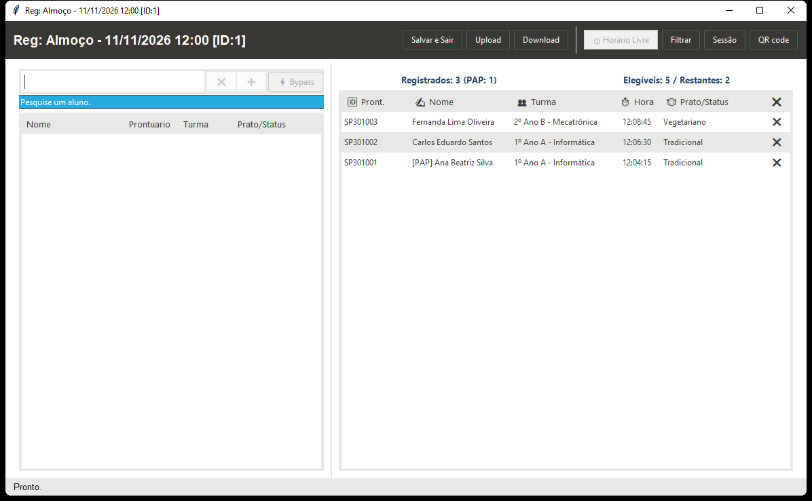
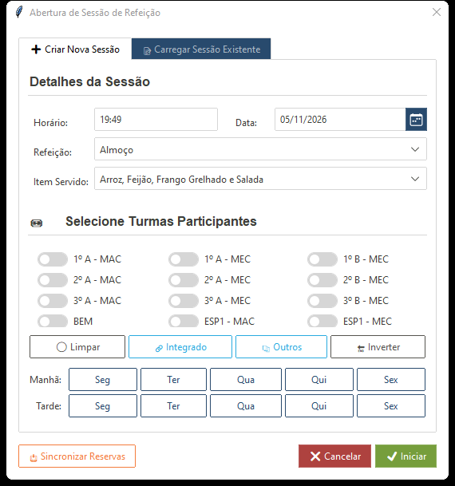
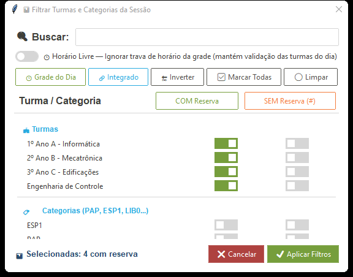
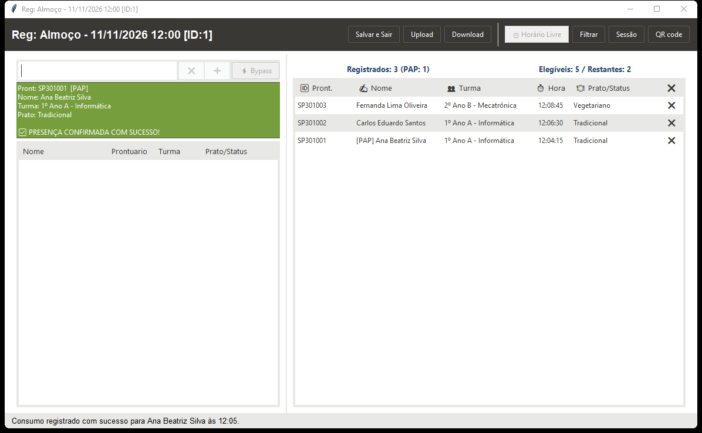
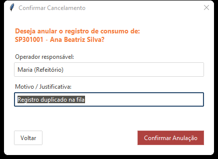

# Capítulo 5 — Terminal do Operador (`Registrar Refeições`)

O **Terminal do Operador** (`registrar` / `--reg`) é a interface de balcão para o atendente controlar sessões, registrar alunos rapidamente por nome ou prontuário, gerenciar exceções e realizar estornos com auditoria.

[⬅️ Capítulo 4 — Regras de Negócio](./04_regras_de_negocio_e_integracao.md) | [📑 Índice](../MANUAL_DO_USUARIO.md) | [Capítulo 6 — Totem de Autoatendimento ➡️](./06_totem_de_autoatendimento.md)

---

## 5.1 Barra Superior e Ciclo de Sincronização

### Botões da Barra Superior (da esquerda para a direita)
1. **Salvar e Sair:** Salva `config/session.json` (`id_sessao`, grupos `#` e estado de `Horário Livre`) e dispara upload final sincronizando os dados com a nuvem antes de encerrar.
   * **Fechamento no `X` da janela:** O sistema executa o upload bloqueante de sincronização antes de fechar, impedindo que consumos recém-lançados deixem de ser enviados ao Google Sheets.
2. **Upload:** Envia imediatamente para o Google Sheets os consumos ativos (nas abas `Almoço`, `Jantar` ou `Lanche`) e os estornos (`Consumo_Cancelados`) da sessão atual.
3. **Download:** Baixa cadastros atualizados (`Discentes`), reservas (`DB`), grade horária (`Configuração`) e lanches (`Lanches`) do Google Sheets para o SQLite local.
   * **Download automático:** Sempre que uma sessão é carregada na inicialização ou trocada, o Terminal dispara um download em segundo plano (com barra de progresso inferior) para manter as listas frescas sem travar a digitação.
4. **🕒 Horário Livre (toggle):** Alterna a flexibilização da trava de horário da grade para a sessão ativa (persiste automaticamente em `session.json`).
5. **Filtrar:** Abre o diálogo avançado **Filtrar Turmas e Categorias** (`DialogoFiltroTurmas`).
6. **Sessão:** Abre o diálogo **Gerenciar Sessão de Refeição** (`DialogoSessao`) em 3 abas.
7. **QR code:** Inicia o **Totem de Autoatendimento** em processo independente (`--auto`). Se não for possível iniciar o subprocesso, abre a janela embutida de fallback (`JanelaSelfService`).

---

## 5.2 Diálogo de Sessão em 3 Abas (`DialogoSessao`)

O diálogo reúne todas as ações de ciclo de vida da sessão, além do botão **📥 Sincronizar Nuvem** no rodapé (útil se você acabou de adicionar reservas na planilha antes de abrir a sessão):

### Aba 1 — ✏️ Editar Sessão Ativa
Visível quando já há uma sessão aberta. Permite alterar refeição, período, data, hora, item de lanche (em `Lanche`, com sincronização bidirecional caso digite um item novo) e os grupos autorizados, além de excluir a sessão ativa com segurança.

### Aba 2 — ➕ Criar Nova Sessão
* **Sugestão inteligente de refeição pelo relógio:**
  * `11:00` até `14:00` ➡️ sugere **`Almoço`**
  * `17:30` até `21:30` ➡️ sugere **`Jantar`**
  * Demais horários ➡️ sugere **`Lanche`**
* **Recálculo automático na alteração de data/refeição:** Ao escolher data no calendário ou sair / pressionar `Enter` no campo de data, o diálogo recalcula imediatamente:
  * **Banner de Reservas Ativas:** Mostra quantas reservas existem para aquela data/turno. **Regra importante:** não é permitido criar uma nova sessão de **Almoço** ou **Jantar** se **não existir nenhuma reserva ativa** para aquela data e turno (sessões de **Lanche** não exigem reservas).
  * **Slots interativos da `🕒 Grade de Horários do Dia`:** Lista as faixas configuradas em `grade_horarios.json` para aquele dia da semana e refeição com indicadores visuais:
    * **`[● Agora]`:** faixa em vigor no horário atual.
    * **`[✓ Filtrado]`:** clique sobre qualquer faixa para filtrar automaticamente apenas as turmas/categorias daquele horário.
    * Botões **Todos os horários** e **🕒 Horário Livre** para alternar rapidamente o escopo.
* **Listas separadas e 6 atalhos de seleção de grupos:**
  * Exibe separadamente os blocos **🏫 Turmas** e **🏷️ Categorias** (com filtro de busca rápida no topo da lista).
  * **Atalhos rápidos:** **🕒 Grade do Dia** (marca grupos previstos na grade), **📋 Com Reserva** (marca apenas grupos que possuem alunos com reserva na data), **🔗 Integrado** (marca turmas de `turmas_integrado.json`), **📚 Outros** (marca o complemento não integrado), **🔄 Inverter** e **⚪ Limpar**.

### Aba 3 — 📂 Carregar Sessão Existente
* Lista todas as sessões gravadas no SQLite em uma tabela ordenável por cabeçalho (ID, Data, Refeição, Período, Hora, Item, Grupos) com campo de filtro ao vivo.
* Dê **duplo clique** em uma sessão (ou selecione e confirme) para carregá-la imediatamente.

---

## 5.3 Filtro Avançado de Turmas e Exceções `#` (`DialogoFiltroTurmas`)

Acessado pelo botão **Filtrar** na barra superior, permite controle granular de quais turmas/categorias exigem reserva prévia e quais entram livremente.

* **Coluna `COM Reserva`:** Autoriza alunos do grupo que possuem reserva válida (ou entrada padrão em Lanche).
* **Coluna `SEM Reserva (#)`:** Marca o grupo em **Exceção (`excecao_grupos`)** — em sessões de **Almoço/Jantar**, alunos dessas turmas ou categorias podem registrar a refeição **mesmo sem ter feito reserva prévia** (o prato é salvo como `Sem Reserva (Grupo)`).
* **Toggle por cabeçalho de coluna:** Clicar diretamente no cabeçalho da coluna `COM Reserva` ou `SEM Reserva (#)` alterna em massa todas as caixas visíveis daquela coluna.
* **Atalhos e controles:** Campo de busca instantânea por nome do grupo, interruptor **`🕒 Horário Livre`**, e 5 botões rápidos: **🕒 Grade do Dia**, **🔗 Integrado**, **🔄 Inverter**, **✅ Marcar Todas** e **⚪ Limpar**.

---

## 5.4 Painel de Busca e Registro (Esquerda)

Concentra a busca rápida na fila e os botões de confirmação.

### Como Funciona a Busca Inteligente
* **Debounce e comprimento mínimo:** A busca dispara automaticamente **100 ms** após parar de digitar quando há pelo menos **2 caracteres**.
* **Correspondência híbrida:** Detecta automaticamente se o termo parece matrícula/prontuário (score ≥ 85) ou nome completo/parcial (score ≥ 70) e exibe o resultado na tabela de elegíveis ordenável.
* **Termos Curinga (listar toda a base disponível):** Digite **`todos`**, **`---`**, **`***`** ou **`..`** para exibir todos os alunos pendentes sem precisar digitar parte do nome.
* **Sufixo ponto final `.` (`pular_grupos`):** Adicionar um `.` ao final de qualquer busca (ex.: `ana.` ou `todos.`) **ativa temporariamente a busca global**, ignorando os filtros de turma da sessão para localizar qualquer aluno ativo do banco na hora.
* **Cartão de Pré-visualização:** Mostra Prontuário, Nome (exibindo as categorias vinculadas entre colchetes, como **`[Evento]`** ou **`[PAP]`**, quando o aluno possui categoria permanente ou pontual), Turma e Prato previsto.

### Atalhos de Teclado e Controles de Registro
| Ação / Tecla | Comportamento |
| :--- | :--- |
| **`Return` (`Enter`)** ou botão **➕ Registrar** | Registra o aluno selecionado respeitando as regras normais da sessão/grade (ou com Bypass se o toggle `⚡ Bypass` estiver ativo). |
| **`Shift + Return`** | Força **Bypass imediato (`pular_grupos=True`)** apenas para aquele registro (ignora filtro de grupos e grade horária, mantendo cota diária e status ativo). |
| **`⚡ Bypass` (toggle)** | Mantém o modo Bypass ligado continuamente para os próximos cliques/Enters até ser desmarcado. |
| **`Up` / `Down` (setas no campo de busca)** | Move a seleção na tabela de elegíveis sem tirar o cursor do campo de busca. |
| **`Escape`** ou botão **❌ Limpar** | Limpa o campo de busca e reinicia a listagem. |
| **Duplo clique na linha** | Confirma e registra o estudante clicado imediatamente. |

---

## 5.5 Painel de Status e Registrados (Direita) e Estorno Auditado

Exibe em tempo real o andamento da refeição:

* **Contadores dinâmicos:** **`Registrados: N (detalhe categorias) | Elegíveis: T | Restantes: R`**.
* **Tabela de Registrados:** Mostra `Matrícula`, `Nome`, `Turma`, `Hora`, `Prato` (com prefixo **`[CAT]`** quando há categorias vinculadas) e a coluna de ação **`❌`**. Todas as colunas podem ser ordenadas clicando no cabeçalho.
* **Estorno / Cancelamento com Auditoria:** Clique diretamente no ícone **`❌`** da linha desejada, ou selecione a linha e pressione **`Delete`** ou **`BackSpace`**. O sistema abrirá o diálogo **`Confirmar Cancelamento`**:

* Informe o **Operador responsável** e o **Motivo / Justificativa** e clique em **Confirmar Anulação**.
* O registro sai da lista de atendidos (via *soft delete*), devolve o aluno para elegíveis/restantes e libera sua cota diária, ficando registrado para auditoria na aba `Consumo_Cancelados`.

---

## 5.6 Janela Embutida de Webcam / QR Code (Fallback `JanelaSelfService`)

Quando você clica no botão **QR code** da barra superior, o sistema inicia o Totem dedicado (`--auto`). Se por algum motivo do ambiente o subprocesso externo não iniciar, abre automaticamente uma janela interna acoplada com leitor de câmera + entrada manual:
* **Webcam com ZBar:** Lê QR Codes continuamente desenhando contorno verde ao redor do código detectado e borda verde de `10 px` no quadro durante o *cooldown* (`20` frames no sucesso, `45` frames no erro, `30` preventivo).
* **Entrada manual por matrícula ou nome:** Padroniza matrículas para `IQ30XXXXX`; se o usuário digitar um nome (≥ 3 caracteres), exibe sugestão em tempo real após **300 ms** (limiar `>= 75`) e, ao pressionar `Enter`, confirma se houver correspondência única clara (`>= 85`, ambiguidade se `< 95` ou diferença `< 10` pontos para o 2º candidato).

---

[⬅️ Capítulo 4 — Regras de Negócio](./04_regras_de_negocio_e_integracao.md) | [📑 Índice](../MANUAL_DO_USUARIO.md) | [Capítulo 6 — Totem de Autoatendimento ➡️](./06_totem_de_autoatendimento.md)

