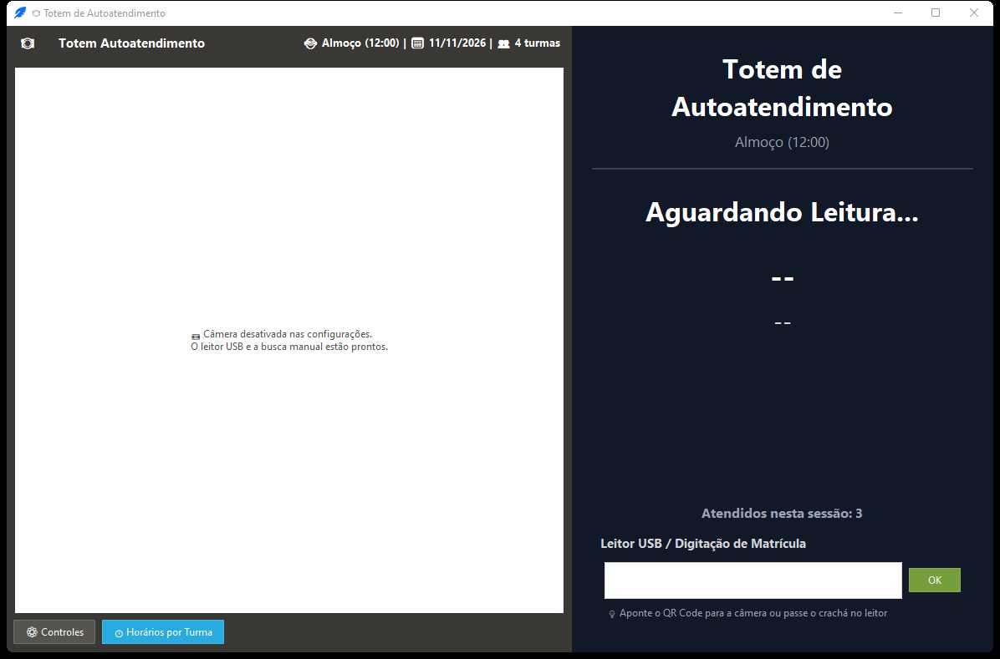
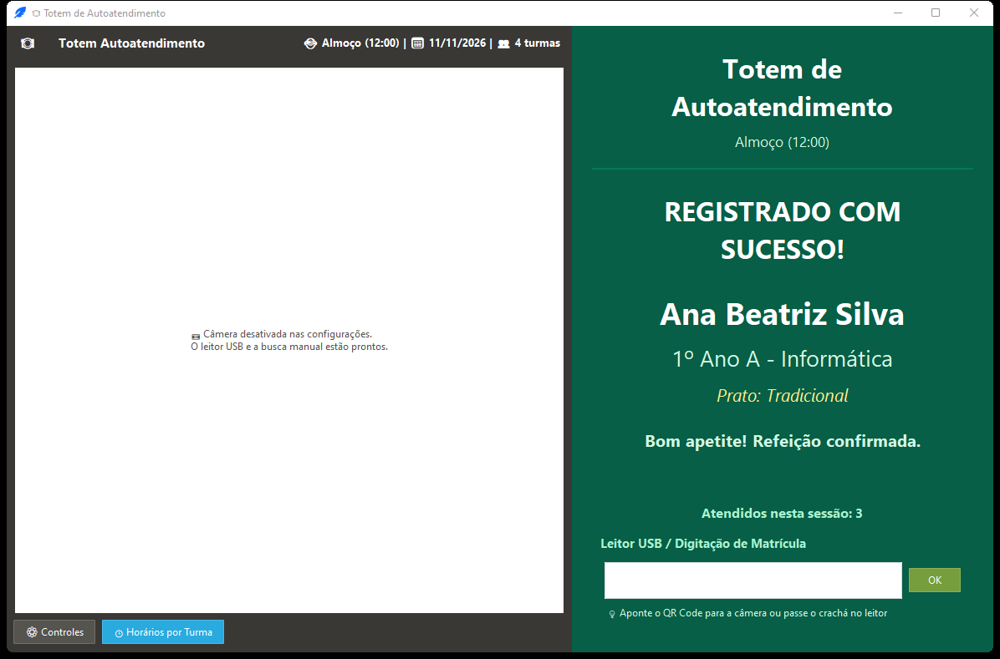
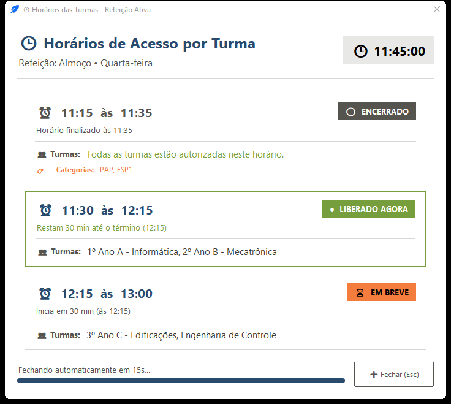
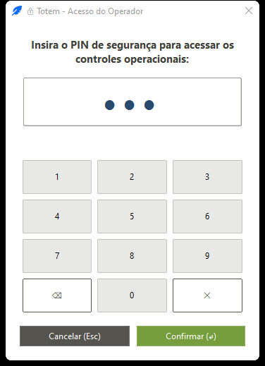
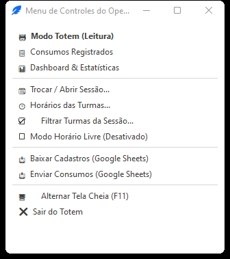
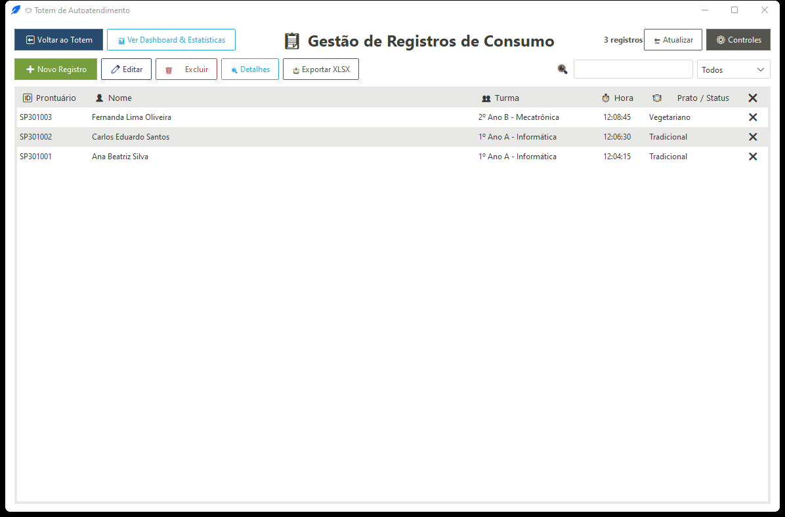
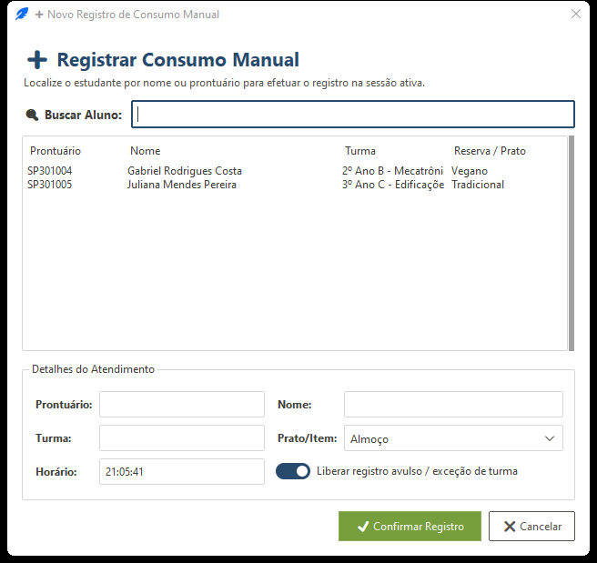
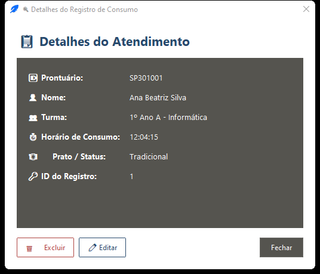
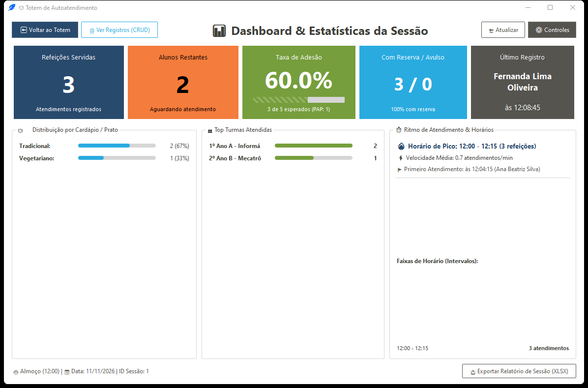

# Capítulo 6 — Totem de Autoatendimento (`Autoatendimento`)

O **Totem de Autoatendimento** (`autoatendimento` / `--auto`) é um módulo autônomo em *ttkbootstrap* projetado para operar em modo quiosque no acesso ao refeitório, combinando leitura por câmera (QR Code), leitor USB de código de barras / digitação direta, consulta interativa de horários para os alunos, painel CRUD completo de consumos e dashboard em tempo real.

[⬅️ Capítulo 5 — Terminal do Operador](./05_terminal_do_operador_registrar.md) | [📑 Índice](../MANUAL_DO_USUARIO.md) | [Capítulo 7 — Gerador de Crachás e Cartões ➡️](./07_gerador_de_crachas.md)

---

## 6.1 Inicialização Autônoma e Tratamento de Sessões

Ao abrir o Totem:
1. Carrega as configurações de `config/settings.json` (`fullscreen`, `camera_on_start`, `require_pin_to_exit`, `feedback_delay_ms`, `camera_index`).
2. Carrega `config/session.json`; se não existir ou estiver inválido, procura automaticamente a **sessão mais recente da data de hoje**.
3. **Liberação automática para datas retroativas:** Se a sessão carregada tiver data diferente da data atual do computador, o Totem ativa automaticamente `ignorar_horario_grade=True` (*Horário Livre*), permitindo lançamentos retroativos sem bloqueio pelo relógio.
4. **Encerramento seguro:** Ao sair pelo botão de fechar ou pelo menu **Sair do Totem** (protegido por PIN quando configurado), salva `session.json` e executa upload bloqueante para o Google Sheets com **timeout máximo de 8 segundos** para evitar perda de dados sem travar indefinidamente caso esteja sem internet.

---

## 6.2 Tela Principal do Totem (`TotemWidget`)

### Elementos da Tela
* **Lado Esquerdo (Captura e Controles):**
  * **Área de Câmera (OpenCV + PyZbar):** Decodifica QR Codes continuamente, desenhando moldura sobre o QR identificado e alterando a borda ao redor do vídeo conforme o resultado (verde no sucesso, vermelho no erro). Se `camera_on_start` estiver desativado ou não houver câmera conectada, o campo USB/manual continua 100% operacional.
  * **Botão `⚙️ Controles`:** Abre o menu flutuante do operador (protegido por PIN se configurado).
  * **Botão `🕒 Horários por Turma`:** Abre a linha do tempo de horários das turmas sem precisar de senha, para consulta rápida dos estudantes na fila.
* **Lado Direito (Feedback e Leitor USB):**
  * **Subtítulo da Refeição Ativa** (ex.: `Almoço • 12/05/2026` — **clicável** para abrir diretamente o diálogo `🕒 Horários por Turma`).
  * **Painel de Status Visual (`padrao` / `sucesso` / `erro`):** Muda inteiramente a cor de fundo, exibe o ícone de status (`Aguardando QR Code...`, `LIBERADO!` ou erro), **Nome**, **Turma**, **Prato/Cardápio**, mensagem detalhada e retorna ao estado padrão após `feedback_delay_ms` (padrão `1500 ms`), emitindo o feedback sonoro configurado.
  * **Campo USB / Digitação Manual:** Recebe leituras de leitor de código de barras (que enviam `Enter` ao final) ou digitação manual. **Redirecionamento global de teclado:** mesmo que o foco do Windows saia da caixa de texto após um clique na tela, qualquer tecla alfanumérica pressionada na tela do Totem é redirecionada automaticamente para o campo de leitura.

### Como o Totem Identifica o Código Lido
1. Se o texto lido contiver dígitos ou `IQ30...`, normaliza para **`IQ30XXXXX`** e chama `registrar_consumo`.
2. Se o retorno for *"Estudante não encontrado"*, realiza busca **fuzzy por nome** entre os alunos elegíveis:
   * Score **≥ 90** com resultado único, ou score **≥ 98**, ou diferença **≥ 10 pontos** sobre o segundo colocado ➡️ registra automaticamente;
   * Caso contrário ➡️ exibe **`Múltiplos resultados encontrados. Digite o prontuário.`**

---

## 6.3 Consulta Viva `🕒 Horários por Turma` (`DialogoGradeHorariosTotem`)

Qualquer estudante (ou operador) pode abrir este modal clicando em **`🕒 Horários por Turma`** ou sobre o **subtítulo da refeição ativa**.

* **Cartões em Linha do Tempo (Timeline):** Exibe todos os slots configurados em `grade_horarios.json` para o dia da semana e refeição da sessão, com relógio atualizado segundo a segundo:
  * **`● LIBERADO (HORÁRIO LIVRE)`:** Quando `Horário Livre` está ligado na sessão.
  * **`● LIBERADO AGORA`:** Slot ativo no minuto corrente (considerando ±5 min de tolerância), exibindo contagem regressiva em minutos até o fim do turno.
  * **`⏳ EM BREVE`:** Slots futuros, mostrando quanto tempo falta para iniciar (`Inicia em X min` ou `XhYYmin`).
  * **`⚪ ENCERRADO`:** Faixas cujo horário + tolerância já terminou.
* **Fechamento automático em 15s (e tecla `Esc`):** Uma barra regressiva fecha a janela após **15 segundos** para o Totem não ficar preso em tela informativa.
* **Leitura contínua com o modal aberto (`permite_leitura_totem=True`):** Se um estudante passar o crachá no leitor USB (finalizado com `Enter`) enquanto o diálogo de horários estiver aberto na tela, a janela captura o código, **fecha imediatamente** e processa o consumo no Totem sem perder a leitura!

---

## 6.4 Proteção por PIN e Menu de Contexto do Operador

Existem **4 formas** de abrir os controles administrativos na janela do Totem:
1. Clicar no botão **`⚙️ Controles`**;
2. Pressionar **`F2`**;
3. Pressionar **`Ctrl + M`**;
4. Clicar com o **botão direito do mouse** em qualquer ponto da tela (**inclusive diretamente sobre o vídeo da câmera**).

Se um PIN estiver configurado e `require_pin_to_exit` estiver ativo, abre primeiro o teclado **`DialogoPIN`** (suporta toque na tela e teclas `0`–`9`, `Enter`, `BackSpace`, `Esc`).

Após validado o PIN (ou imediatamente se não houver PIN), surge o menu flutuante completo do operador:

| Opção no Menu | Função |
| :--- | :--- |
| **🤖 Modo Totem (Leitura)** | Retorna à tela principal de leitura QR/USB. |
| **📋 Consumos Registrados** | Abre a visão CRUD de todos os atendimentos da sessão (`AbaConsumos`). |
| **📊 Dashboard & Estatísticas** | Abre o painel analítico da sessão (`AbaDashboard`). |
| **📆 Trocar / Abrir Sessão...** | Abre o diálogo completo `DialogoSessao` para criar, editar ou trocar a sessão ativa do Totem. |
| **🕒 Horários das Turmas...** | Abre o modal visual `DialogoGradeHorariosTotem`. |
| **☑️ Filtrar Turmas da Sessão...** | Abre o `DialogoFiltroTurmas` (COM Reserva / SEM Reserva `#` / Horário Livre). |
| **Modo Horário Livre** (check) | Liga/desliga `ignorar_horario_grade` diretamente do menu e persiste em `session.json`. |
| **📥 Baixar Cadastros (Google Sheets)** | Baixa alunos, reservas, grade horária e lanches da nuvem em segundo plano. |
| **📤 Enviar Consumos (Google Sheets)** | Faz upload imediato dos consumos e cancelamentos da sessão. |
| **🖥️ Alternar Tela Cheia (`F11`)** | Liga/desliga fullscreen (tecla `Esc` também sai do modo tela cheia). |
| **❌ Sair do Totem** | Salva estado, envia pendências para o Google Sheets (até 8s) e encerra o módulo. |

---

## 6.5 Visão 📋 Consumos Registrados (`AbaConsumos`)

Permite inspecionar, corrigir e lançar consumos manualmente direto do próprio Totem (ideal para quando o atendente está atuando junto ao quiosque).

### Barra Superior e Filtros
* Navegação rápida: **⬅ Voltar ao Totem**, **📊 Ver Dashboard & Estatísticas**, **🔄 Atualizar**, **⚙️ Controles**.
* **Busca ao vivo** (matrícula, nome, turma ou prato) + filtro suspenso (**`Todos`**, **`Com Reserva`**, **`Sem Reserva`**) + contador dinâmico (`N registros` ou `X de Y registros`).
* **Tabela ordenável** com coluna de ação rápida **`❌`** no canto direito.
* **Atalhos da tabela:** **Duplo clique** na linha abre **Detalhes**; **botão direito** abre menu de contexto (`Ver Detalhes`, `Editar Horário / Prato`, `Excluir Registro`); **`Delete`** ou **`BackSpace`** abre o diálogo de estorno auditado.

### Sub-diálogos de CRUD no Totem

* **➕ Novo Registro (`DialogoNovoConsumo`):** Busca alunos ativos, exibe lista de candidatos ordenável, permite preencher **Horário** e **Prato/Cardápio**, e inclui opção de registro com regras normais ou liberação avulsa (bypass de grupo/horário).

* **✏️ Editar (`DialogoEditarConsumo`):** Altera o horário gravado (`hora_consumo`) e o prato da reserva vinculada (se o consumo anterior era avulso sem reserva vinculada, o sistema cria/associa automaticamente uma reserva na data com o prato informado para manter consistência nos relatórios).
* **🗑️ Excluir (`DialogoConfirmarCancelamento`):** Executa estorno via *soft delete* solicitando **Operador responsável** e **Motivo / Justificativa**.
* **🔍 Detalhes (`DialogoDetalhesConsumo`):** Cartão completo exibindo Prontuário, Nome, Turma, Horário de Consumo, Prato/Status e ID interno do registro, com botões rápidos para **Editar** ou **Excluir** diretamente dali.

* **📥 Exportar XLSX:** Gera a planilha completa da sessão (incluindo aba `Cancelados` se houver estornos) diretamente na pasta **Documentos**.

---

## 6.6 Visão 📊 Dashboard & Estatísticas (`AbaDashboard`)

Painel de acompanhamento instantâneo da fila atual dentro do Totem.

* **5 Cartões de KPI:**
  1. **Refeições Servidas** (total de consumos ativos na sessão);
  2. **Alunos Restantes** (elegíveis ainda não atendidos);
  3. **Taxa de Adesão** (porcentagem de atendidos sobre esperados + barra de progresso e resumo das principais categorias atendidas, ex.: `PAP: N`);
  4. **Com Reserva / Avulso** (`c_res / s_res` e % com reserva);
  5. **Último Registro** (nome e horário do último estudante atendido).
* **3 Painéis Analíticos:**
  * **Distribuição por Cardápio / Prato** (barras proporcionais por prato);
  * **Top Turmas Atendidas** (até as 6 turmas com maior volume na sessão);
  * **Ritmo de Atendimento & Horários** (**Horário de Pico** em janelas de 15 minutos, **Velocidade Média** em atendimentos/minuto, **Primeiro Atendimento** e últimos 5 intervalos de 15 min).
* **Rodapé:** Resumo da sessão ativa (`Refeição`, `Hora prevista`, `Item`, `Data`, `ID Sessão`) e botão **📥 Exportar Relatório de Sessão (XLSX)** salvando na pasta **Documentos**.

---

[⬅️ Capítulo 5 — Terminal do Operador](./05_terminal_do_operador_registrar.md) | [📑 Índice](../MANUAL_DO_USUARIO.md) | [Capítulo 7 — Gerador de Crachás e Cartões ➡️](./07_gerador_de_crachas.md)

