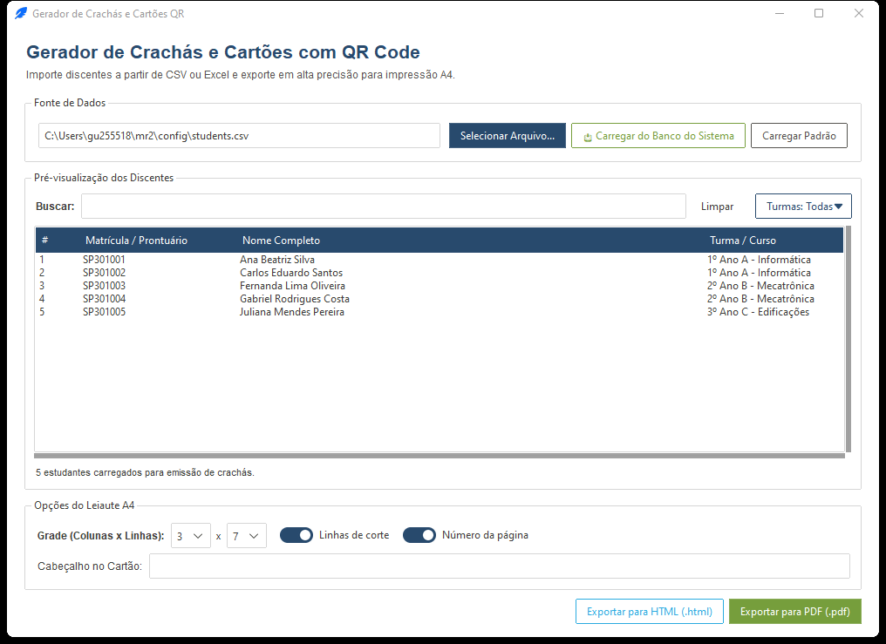

# 7. Gerador de Crachás (`registro.cards`)

O **Gerador de Crachás** é um aplicativo integrado para produzir cartões de identificação estudantil com QR Code em lote, prontos para impressão em papel A4 comum ou cartão e recorte em guilhotina.



---

## 7.1. Como Abrir o Gerador

Você pode iniciar o módulo por três caminhos:

1. Pelo **Menu Inicial** (`uv run python -m registro`): clique no botão **🪪 Gerador de Crachás...**.
2. Diretamente pelo argumento de linha de comando:
   ```bash
   uv run python -m registro --cards
   ```
3. Executando o pacote de crachás isoladamente:
   ```bash
   uv run python -m registro.cards
   ```

---

## 7.2. Fontes de Dados Suportadas

Na parte superior da janela, escolha de onde virá a lista de estudantes:

| Fonte | Como funciona | Detalhes automáticos |
| :--- | :--- | :--- |
| **Banco de Dados (SQLite)** | Lê diretamente a base local do sistema (`config/registro.db` ou outro `.db` escolhido). | Traz os estudantes **ativos** com suas respectivas **turmas** (`tipo="turma"`), sem precisar exportar planilhas antes. |
| **Planilha (CSV / XLSX)** | Permite abrir qualquer arquivo `.csv` ou `.xlsx` (Excel) salvo no computador. | Detecta automaticamente encoding (`utf-8-sig`, `utf-8`, `latin-1`, `cp1252`), delimitador CSV (`,`, `;`, `\t`, `\|`) e nomes flexíveis de colunas. |

> [!TIP]
> Colunas aceitas automaticamente em planilhas externas: variações de `pront` / `prontuario` / `matricula` / `ra`, `nome` / `estudante` / `aluno`, `turma` / `curso` / `grupo`, e opcionalmente `ativo` / `status` / `situacao`.

---

## 7.3. Filtros e Seleção de Estudantes

Depois de clicar em **Carregar Dados**, utilize os filtros para emitir crachás apenas para quem precisa (por exemplo, somente turmas ingressantes ou segunda via):

1. **Busca instantânea**: digite parte do nome, matrícula/prontuário ou nome da turma.
2. **Filtro multiseleção de Turmas**: marque ou desmarque as turmas desejadas nos seletores individuais, ou use os botões rápidos **Todas** / **Nenhuma**.
3. **Seleção fina na lista**: clique nos estudantes desejados (use `Ctrl+Clique` ou `Shift+Clique` ou os botões de seleção em lote da barra) — o rodapé mostra quantos estudantes serão incluídos na impressão.

---

## 7.4. Configuração de Layout e Impressão (A4)

O painel de layout ajusta o formato físico da folha **A4**:

* **Grade (Colunas × Linhas)**:
  * **Colunas**: de **2 a 4** colunas por folha.
  * **Linhas**: de **4 a 10** linhas por folha.
  * Exemplo clássico: **3 colunas × 5 linhas** = **15 crachás por página A4**.
* **Título do Cabeçalho**: texto institucional exibido no topo de cada cartão (no exportador **PDF**, o título do cabeçalho tem limite de **40 caracteres** para evitar estouro lateral na área do cartão).
* **Subtítulo e Cores**: personalize o subtítulo identificador (ex.: *Refeitório Estudantil*) e a cor de destaque das bordas/faixas.
* **Guias de Recorte e Paginação**:
  * **Linhas de corte**: desenha marcas/linhas finas de referência entre as células para facilitar o corte na guilhotina ou tesoura.
  * **Numeração de páginas**: imprime o número da página no rodapé da folha A4, útil ao imprimir lotes grandes para várias turmas.

---

## 7.5. O QR Code Gerado e Formatos de Exportação

### Conteúdo do QR Code

Cada crachá carrega um QR Code contendo **exclusivamente o prontuário/matrícula puro** do estudante (por exemplo, `SP301001`), sem URLs ou prefixos extras. Isso garante compatibilidade imediata com:
* A **webcam** do [Totem de Autoatendimento](06_totem_de_autoatendimento.md) e do módulo Self-Service do Operador;
* **Leitores USB** de código de barras 2D/QR no [Terminal do Operador](05_terminal_do_operador_registrar.md) ou no campo de entrada do Totem.

### Formatos de Saída

| Formato | Tecnologia | Quando escolher |
| :--- | :--- | :--- |
| **PDF Vetorial (`.pdf`)** | ReportLab | **Recomendado para impressão em gráfica ou impressora do campus**: QR Codes nítidos sem serrilhado, medidas exatas em milímetros e linhas de corte precisas. |
| **HTML (`.html`)** | CSS Grid | Gera um único arquivo web auto-contido que abre no navegador para conferência visual rápida ou impressão direta via `Ctrl+P` (lembre de ativar *"Gráficos de segundo plano"* nas opções de impressão do navegador). |

---

* **Anterior:** [6. Totem de Autoatendimento](06_totem_de_autoatendimento.md)
* **Próximo:** [8. Rotinas do Dia a Dia](08_rotinas_do_dia_a_dia.md)

